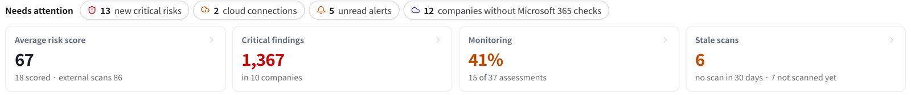
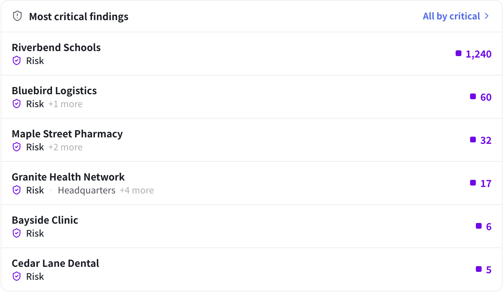

Insights summarizes scores, critical findings, monitoring, and scan age across all your
companies. Open it from **Insights** in the top navigation. It is built on the same data as
the [Companies](/getting-started/companies) page, so its counts match the counts there, and
almost every number on it opens the matching filtered view of the Companies list.

<Note>
  The portal labels Insights as a preview and asks for feedback at the top of the page.
</Note>

If your account has no companies yet, Insights shows a short introduction and a **New
assessment** button instead of the sections below.

## What needs attention

The first row lists the reasons companies need work, each with a count. A reason only appears
when its count is above zero.

| Item | Opens |
| --- | --- |
| new critical risks | Companies filtered to new critical risks |
| agents offline | Companies filtered to offline agents |
| failed deployments | Companies filtered to failed agent deployments |
| cloud connections | Companies filtered to cloud connections that need fixing |
| unread alerts | The Alerts page |
| companies without Microsoft 365 checks | Companies where Microsoft 365 or Google Workspace is not fully connected |
| PSA companies not imported | Companies not linked to your PSA |

<Frame>
  
</Frame>

## Portfolio figures

Four tiles summarize the portfolio. Each one opens the Companies list sorted or filtered to
match.

| Tile | What it shows | Opens |
| --- | --- | --- |
| Average risk score | The average score of your scored risk assessments, with the external scan average underneath | Companies, lowest score first |
| Critical findings | Open critical findings across all assessments, and how many companies have them | Companies, most critical first |
| Monitoring | The share of assessments with monitoring turned on | Companies with monitoring off |
| Stale scans | Assessments with no scan in the last 30 days, and how many were never scanned | Companies, oldest scan first |

## Score distribution

This panel shows how scored assessments spread across four score bands, with separate bars
for risk assessments and external scans.

| Band | Score range |
| --- | --- |
| Low | 0 to 19 |
| Fair | 20 to 49 |
| Good | 50 to 79 |
| High | 80 to 100 |

## Most critical findings and lowest scores

**Most critical findings** lists the six companies with the most open critical findings.
Each row opens the company's assessment with the most critical findings at its prioritized
findings view. **All by critical** opens the full Companies list in that order.

<Frame>
  
</Frame>

**Lowest scores** lists the six companies whose worst assessment has the lowest score. Each
row opens that assessment, and **All by score** opens the full Companies list in that order.

## Fixes that raise the lowest scores most

This panel takes the remediation actions from up to 25 of your lowest-scoring risk
assessments, groups the same fix across assessments, and ranks the fixes by the total score
gain they would bring. Each row shows the finding, its severity, how many assessments it
affects, and the average score gain per affected assessment. A row opens the assessment that
gains most from that fix.

The calculation runs when you open the page. Click **Recalculate** to run it again after
new scans finish. Until your risk assessments have been scanned, the panel stays empty.

<Warning>
  Because the panel only looks at the lowest-scoring risk assessments, a fix that matters
  across many higher-scoring clients can be missing from it.
</Warning>

## Related guides

<CardGroup cols={2}>
  <Card
    title="Companies"
    icon="building"
    href="/getting-started/companies"
  >
    The full list of companies and assessments that Insights links into
  </Card>
  <Card
    title="Alerts"
    icon="bell"
    href="/products/risk-monitoring/alerts"
  >
    What each alert category means and who gets notified
  </Card>
</CardGroup>
