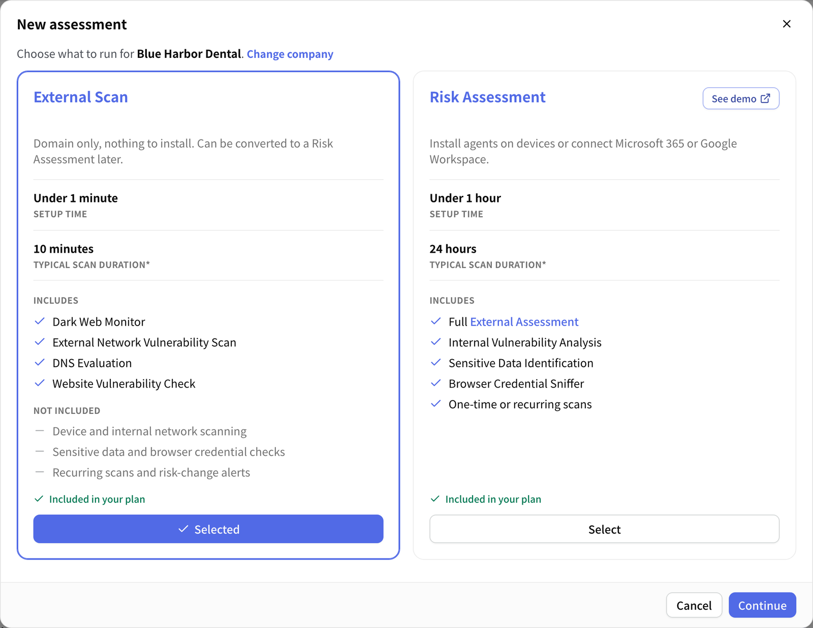

This page walks through the order most MSPs follow in their first week with Telivy. Each
step links to the full guide.

<Steps>
  <Step title="Set up your account" icon="user-gear">
    Add your agency logo and invite teammates. Only account admins can open the **Account**
    area. Multi-factor authentication is on for every Telivy email and password login, so each user
    registers an authenticator app the first time they log in. If your agency signs in through
    Unity, users choose **Sign in with Cytracom** and use Unity's sign-in instead. See [Unity and Cytracom](/getting-started/set-up-telivy-account/unity).

    [Account settings overview](/getting-started/set-up-telivy-account/overview) ·
    [Multi-factor authentication](/getting-started/set-up-telivy-account/multi-factor-authentication)
  </Step>
  <Step title="Run an External Assessment" icon="globe">
    Select **Create Assessment**, pick **External Scan**, and enter the company name and
    domain. Nothing is installed, and the scan usually finishes in about ten minutes. It is
    the quickest way to show a prospect their public exposure.

    <Frame>
      
    </Frame>

    [Start an External Assessment](/products/external-assessments/start-an-external-assessment)
  </Step>
  <Step title="Start a Risk Assessment for a client" icon="shield-halved">
    A Risk Assessment adds internal vulnerabilities, sensitive data on devices, saved
    browser passwords, and Microsoft 365 or Google Workspace. Setup takes under an hour, and
    the scan usually finishes about 24 hours after the agents are deployed.

    [Start a Risk Assessment](/products/risk-assessments/start-a-new-risk-assessment)
  </Step>
  <Step title="Deploy the Telivy agent" icon="download">
    Allow Telivy in the client's antivirus or EDR first, then run the install command from
    your RMM or the installer on each Windows PC or Mac. Use the agentless scanner when you
    cannot install software.

    [Agent vs Agentless](/products/risk-assessments/agent-vs-agentless) ·
    [Allow in AV and EDR](/products/risk-assessments/whitelist-telivy-with-av-edr) ·
    [Allow in ThreatLocker](/products/risk-assessments/allow-telivy-in-threatlocker) ·
    [Install on Windows](/products/risk-assessments/install-telivy-agent-windows) ·
    [Install on macOS](/products/risk-assessments/install-telivy-agent-macos)
  </Step>
  <Step title="Review the findings and the score" icon="gauge-high">
    Open the assessment to see the Risk Score, vulnerabilities ranked by Risk Priority Score,
    and the letter grade for each report section.

    [Navigating an assessment](/products/navigating-an-assessment) ·
    [Risk Score](/scoring/risk-scoring) ·
    [Report grading criteria](/scoring/grading-criteria) ·
    [Risk Register](/products/risk-register)
  </Step>
  <Step title="Share a report with the client" icon="file-lines">
    On the assessment's **Reports** tab, select **Generate New Report** and pick a report
    type.

    [Generate reports](/products/reports)
  </Step>
  <Step title="Keep the client monitored" icon="bell">
    Turn on Continuous Monitoring to rescan on a schedule, and set up alerts for new
    breaches and critical vulnerabilities between rescans. Connect your PSA so findings
    become tickets.

    [Risk Monitoring](/products/risk-monitoring/overview) ·
    [Alerts](/products/risk-monitoring/alerts) ·
    [Integrations](/integrations/overview)
  </Step>
</Steps>

<Note>
  Stuck on an install? The [installation and troubleshooting FAQ](/frequently-asked-questions/installation-and-troubleshooting)
  covers the common problems, and [Get Help](/help/get-help) lists how to reach the Telivy
  team.
</Note>
