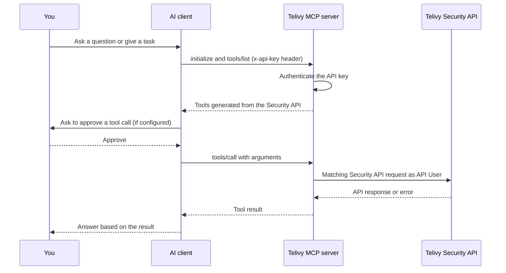

Telivy runs a remote [Model Context Protocol](https://modelcontextprotocol.io) (MCP) server at `https://api-v1.telivy.com/mcp`. An MCP-capable AI assistant, such as Claude Code, Cursor or GitHub Copilot in VS Code, can connect to it and work with your Telivy data in conversation: it can list your external scans and risk assessments, read findings, start new scans and rescans, and gather the details you need for a client report.

The server uses the Streamable HTTP transport and authenticates with your agency's Telivy API key, the same key the Telivy Security API and integrations such as Rewst use.

## Prerequisites

- A Telivy agency account with access to **Account → Integrations** in the portal.
- Your agency's Telivy API key (see [Get your API key](#get-your-api-key)).
- An MCP client that can send a custom HTTP header with each request, or that can run the `mcp-remote` bridge locally. The client pages linked at the end of this page cover the supported clients.

## How it works

Your AI client sends MCP requests to `https://api-v1.telivy.com/mcp` with your API key in the `x-api-key` header. Telivy checks the key, then answers the client's request for the list of available tools. Each tool is generated from an operation in the [Telivy Security API](https://api-v1.telivy.com/api-docs/security). When the assistant calls a tool, Telivy runs it as the matching Security API request under your agency's API User. Validation, permissions and error responses are therefore the same as when you call the API directly, and the result goes back to the assistant as the tool's output.

The assistant decides which tools to call based on your prompt and the tool descriptions. It only sees the data that the tools return, and it can only do what the Security API allows your API key to do.

## Authentication and permissions

### Get your API key

1. Sign in to the Telivy portal and open [Account → Integrations](https://portal.telivy.com/agent/account/integrations).
2. Generate the API key, or copy it if you already have one, and store it somewhere safe such as a password manager.

Telivy shows the key only once, when it is generated. Each agency has one API key, and every integration and MCP client your agency uses shares it.

<Warning>
  Regenerating the API key immediately invalidates the old key. Every MCP client and every integration that uses the old key (for example Rewst workflows) stops working until you update it with the new key.
</Warning>

### What the key can do

The API key acts as your agency's built-in **API User**, which has agency administrator permissions. Anything an assistant does through the MCP server is done with those permissions, and it appears in Telivy as performed by **API User** rather than by the person who typed the prompt.

Signing in per user (OAuth) is not supported at the moment. Because of this, AI products whose remote connectors only offer an OAuth sign-in, such as ChatGPT connectors and the custom connector dialog in Claude on the web, cannot connect to the Telivy MCP server. Anthropic is testing a **Request headers** option for Claude custom connectors with a limited set of organizations; Telivy has not tested that option. Claude Desktop can connect through the local `mcp-remote` bridge described in [Claude Desktop](/integrations/mcp/claude-desktop).

## What you can do

The MCP server exposes the operations of the [Telivy Security API](https://api-v1.telivy.com/api-docs/security) as tools, so the assistant can do what the API can do. The tools fall into these groups:

- **External scans:** list and get external scans, create and update them, read their findings, start a rescan, read breach data, get reports, and uninstall agents.
- **Risk assessments:** list and get risk assessments, create and update them, convert them, read and change monitoring settings, list devices and rescan a device, check scan status, list Microsoft 365 and Google Workspace users, and read the PII summary.
- **Security findings:** read the details of a security finding.
- **Agent versions:** list the available Telivy agent versions.

The tool names, parameters and response fields follow the Security API. For the full list of operations and their parameters, see the [API reference](https://api-v1.telivy.com/api-docs/security).

Each tool carries MCP annotations. Tools that only read data are marked read-only, and tools that remove or disrupt something, such as uninstalling agents, are marked destructive. Clients that honor these annotations can run read-only tools without interrupting you and ask for confirmation before destructive ones.

## Safety recommendations

Configure your client to ask for approval before it runs any Telivy tool that creates, updates, rescans or uninstalls something. Most clients ask before every MCP tool call by default; keep that default for Telivy, or let only read-only tools run automatically. Each client page says where this setting is.

When the client asks for approval, check which tool the assistant chose and the arguments it filled in, especially the assessment or scan ID, before you approve an action that changes data.

Keep the API key in an environment variable or in the client's secret storage, and reference it from the configuration. Do not commit a configuration file that contains the key to a repository, and do not paste the key into the chat. If the key leaks, regenerate it under **Account → Integrations** and update every MCP client and integration that used the old key.

## Rate limits

MCP traffic is subject to the same per-key rate limit as the Telivy partner API. Each tool call counts as one API request against your agency's key, and the limit is shared with any other integration that uses the same key. When the limit is reached, tool calls fail with a `429` error until the rate-limit window passes. Long chains of tool calls, such as asking the assistant to open every assessment one by one, use the limit up faster than a single list request.

## Troubleshooting

<AccordionGroup>
  <Accordion title="401 Unauthorized or invalid API key">
    The server did not accept the key in the `x-api-key` header. Check that the header name is exactly `x-api-key`, that the value is the full key with no extra spaces or quotes, and that the environment variable your configuration references is set in the environment the client was started from. If the key was regenerated, the old key no longer works and every client needs the new one.
  </Accordion>
  <Accordion title="429 Too Many Requests">
    Your agency's key reached its rate limit. Wait for the limit window to pass before retrying, and ask the assistant to use list operations with filters instead of fetching records one at a time. Other integrations that use the same key, such as Rewst workflows, count toward the same limit.
  </Accordion>
  <Accordion title="The client cannot connect or the header is not sent">
    Check that the URL is exactly `https://api-v1.telivy.com/mcp` and that the client is set to the HTTP (Streamable HTTP) transport, not SSE. If the client reports a `401` while the key is correct, the header is probably not being sent: confirm the header is defined in the server entry that the client actually loads, and that any variable such as `${env:TELIVY_API_KEY}` resolves. Desktop applications on macOS do not read your shell profile when started from the Dock, so start the client from a terminal or define the variable where the client documentation says. If your client cannot send custom headers at all, use the `mcp-remote` bridge as shown on the [Claude Desktop](/integrations/mcp/claude-desktop) page.
  </Accordion>
  <Accordion title="The server connects but no tools show up">
    Restart or reload the MCP server in your client so it requests the tool list again, then open the client's MCP or tools view to check that the Telivy tools are listed and enabled. Some clients cap the total number of tools across all servers, or let you turn off individual tools; turn off tools from other servers that you do not need, or turn the Telivy tools back on.
  </Accordion>
  <Accordion title="Everything stopped working after the key was regenerated">
    Regenerating the API key invalidates the old key for every MCP client and integration. Update the key in each client's environment variable or secret storage, restart the client, and update the key in your other integrations.
  </Accordion>
</AccordionGroup>

## Set up your client

<CardGroup cols={2}>
  <Card title="Claude Code" href="/integrations/mcp/claude-code">
    Add Telivy from the command line or in a project `.mcp.json` file.
  </Card>
  <Card title="Claude Desktop" href="/integrations/mcp/claude-desktop">
    Connect through the local `mcp-remote` bridge.
  </Card>
  <Card title="Cursor" href="/integrations/mcp/cursor">
    Add Telivy to `mcp.json` with the key in an environment variable.
  </Card>
  <Card title="VS Code (GitHub Copilot)" href="/integrations/mcp/vscode">
    Use Telivy tools in Copilot agent mode.
  </Card>
  <Card title="Windsurf (Devin Desktop)" href="/integrations/mcp/windsurf">
    Add Telivy to the MCP configuration file.
  </Card>
  <Card title="OpenAI Codex CLI" href="/integrations/mcp/codex">
    Add Telivy to `config.toml`.
  </Card>
</CardGroup>

For prompts that MSP teams use with the Telivy MCP server, see [Example workflows](/integrations/mcp/example-workflows).
