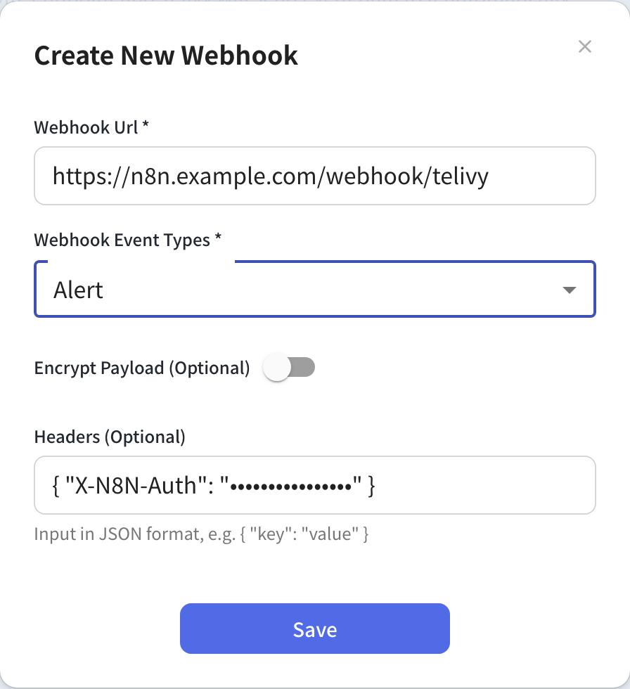

[n8n](https://n8n.io) is a workflow automation tool that connects more than 400 apps. With
Telivy's [webhooks](/integrations/webhooks) and [Security API](/integrations/api), an n8n
workflow can react to Telivy events as they happen, or pull Telivy data on a schedule and
send it wherever your team works. It runs on n8n Cloud or on your own server, and nothing
needs to be installed in Telivy.

## What you can build

| Workflow | Telivy side | n8n side |
| --- | --- | --- |
| Post new security alerts to a channel | `ALERT_RAISED` webhook | Slack, Microsoft Teams, or Discord |
| Warn the account manager when a client's grade drops | `SECURITY_GRADE_CHANGED` webhook | Gmail, Outlook, or a CRM such as HubSpot |
| Log every finished external scan | `SCAN_COMPLETED` webhook | Google Sheets, Airtable, or Notion |
| Track agent rollout per client | `AGENT_INSTALLED` and `AGENT_UNINSTALLED` webhooks | Google Sheets or a project board |
| Weekly grade report for all prospects | `GET /api/v1/security/external-scans` on a schedule | Google Sheets, then an email summary |
| Open a ticket in a tool Telivy does not integrate with | `ALERT_RAISED` webhook | Jira, Linear, Freshservice, or any HTTP API |

If your PSA is ConnectWise, Autotask, or HaloPSA, use Telivy's built-in
[PSA integrations](/integrations/overview#psa) for tickets instead. They also close the
finding in Telivy when the ticket closes, which a one-way n8n workflow does not do.

## Receive Telivy events in n8n

<Steps>
  <Step title="Add a Webhook trigger in n8n">
    Create a workflow and add a **Webhook** node. Set **HTTP Method** to `POST` and give it a
    **Path**, such as `telivy`. Under **Respond**, choose **Immediately**, so Telivy gets its
    `200` response before the rest of the workflow runs.
  </Step>
  <Step title="Protect the webhook with a header">
    In the Webhook node, set **Authentication** to **Header Auth** and create a credential
    with a header name such as `X-N8N-Auth` and a long random value. n8n then rejects any
    request that does not carry that header.
  </Step>
  <Step title="Create the webhook in Telivy">
    In the Telivy portal, open **Account → Webhooks** and add a webhook. Paste the Webhook
    node's **Production URL** as the destination and pick the events you want. In
    **Headers (Optional)**, enter the n8n credential's header as JSON, for example
    `{"X-N8N-Auth": "your-long-random-value"}`. See
    [Setting up webhooks](/integrations/webhooks#setting-up-webhooks).

    <Frame>
      
    </Frame>
  </Step>
  <Step title="Test, then publish">
    In n8n, select **Listen for test event** and switch the URL in Telivy to the **Test URL**
    while you build. Use the test button on the Telivy webhook to send a `TEST` event. When
    the workflow works, switch Telivy back to the **Production URL** and publish the
    workflow in n8n.
  </Step>
</Steps>

Each request arrives in n8n with the event under `body`. Route events with a **Switch** node
on `{{ $json.body.metadata.eventType }}`, and read the event's fields from
`{{ $json.body.data }}`. For example, a `SECURITY_GRADE_CHANGED` event carries
`{{ $json.body.data.domain }}`, `{{ $json.body.data.previousGrade }}` and
`{{ $json.body.data.grade }}`. [Webhook events](/integrations/webhooks#webhook-events) lists
the fields for every event.

<Note>
  Telivy retries a failed delivery, so the same event can reach n8n more than once. If a
  duplicate would cause harm, such as a second ticket, check `metadata.attemptNumber` or keep
  a record of the IDs you have already handled.
</Note>

## Call the Security API from n8n

<Steps>
  <Step title="Create the API credential">
    In n8n, create a **Header Auth** credential with the name `x-api-key` and your agency's
    Telivy API key as the value. [Get your API key](/integrations/api#get-your-api-key)
    explains where to find it.
  </Step>
  <Step title="Add an HTTP Request node">
    Set **Method** to `GET` and **URL** to an endpoint such as
    `https://api-v1.telivy.com/api/v1/security/external-scans`. Under **Authentication**,
    choose **Generic Credential Type**, then **Header Auth**, and select the credential.
  </Step>
  <Step title="Work with the results">
    The external scans endpoint returns the scans in an `assessments` array with a `total`
    count. Add a **Split Out** node on `assessments` to get one item per scan, then map fields
    such as `assessmentDetails.organization_name`, `assessmentDetails.domain_prim`,
    `securityScore` and `lastScannedAt` into the next node.
  </Step>
</Steps>

For a weekly report, start the workflow with a **Schedule Trigger**, call the endpoint, and
append the rows to Google Sheets. The [Security API](/integrations/api) page lists every
endpoint, and the interactive reference shows each response in full.

<Warning>
  The API key has agency administrator rights and can change data as well as read it. Keep
  it in an n8n credential, never in a node's URL or body, and use only `GET` requests in a
  workflow that should only read. Regenerating the key in Telivy stops every workflow that
  uses it until you update the credential.
</Warning>

## Related guides

<CardGroup cols={2}>
  <Card title="Webhooks" icon="webhook" href="/integrations/webhooks">
    Every event, payload fields, signatures, and retries
  </Card>
  <Card title="Security API" icon="code" href="/integrations/api">
    Endpoints, authentication, and the interactive reference
  </Card>
</CardGroup>
