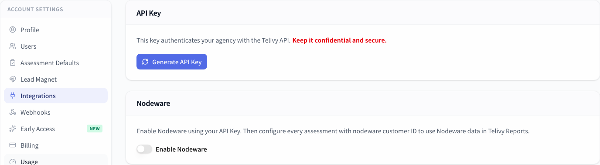
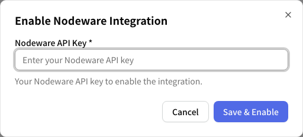
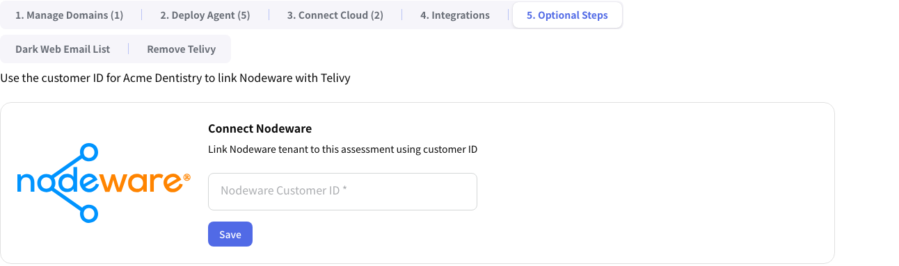

Connecting Nodeware brings a client's Nodeware network scan data into their Telivy Risk Assessment. You add your Nodeware API key once for the agency, then link each assessment to the matching Nodeware customer.

## Connect Nodeware

1. In Telivy, go to **Account → Integrations → General** and enable Nodeware.

   <Frame>
     
   </Frame>
2. Enter your Nodeware API key and save.

   <Frame>
     
   </Frame>
3. In Nodeware, open the client and click **Manage Customer**.

   <Frame>
     
   </Frame>
4. Copy the **Customer ID** shown in the sidebar.

   <Frame>
     
   </Frame>
5. In Telivy, open the same client's Risk Assessment, go to **Setup → Optional Steps → Connect Nodeware**, and add the customer ID.

   <Frame>
     
   </Frame>

Telivy starts fetching Nodeware data after you save. It shows up under **Security → Network** within 24 hours.
