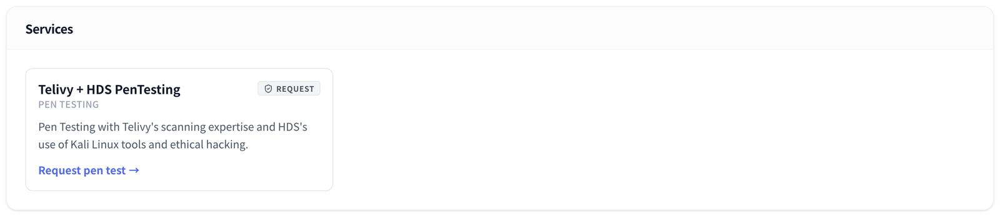
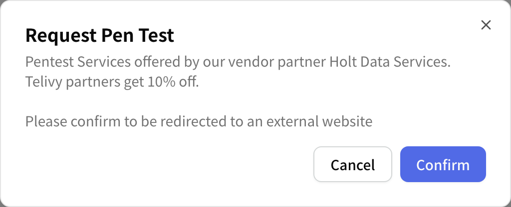

Telivy partners with Holt Data Services (HDS) for penetration testing. HDS runs the test with Kali Linux tools and ethical hacking, building on what Telivy's scans have already found. You start the request from the client's assessment in Telivy and complete it with HDS.

## Where the tile is

The **Telivy + HDS PenTesting** tile is in the **Services** card at the bottom of an assessment's integrations page:

- On a Risk Assessment, open the **Setup** tab and select **4. Integrations**.
- On an External Assessment, open the **Setup** tab and select **4. Integrations**.

<Frame>
  
</Frame>

Agencies with their own master logo (white-label partners) do not see the **Services** card or the tile.

## Requesting a test

<Steps>
  <Step title="Open the tile">
    Select **Request pen test** on the **Telivy + HDS PenTesting** tile. The **Request Pen Test** dialog opens.
  </Step>
  <Step title="Confirm">
    The dialog explains that the service is offered by HDS and that Telivy partners get 10% off. Select **Confirm**.

    <Frame>
      
    </Frame>
  </Step>
  <Step title="Continue on the HDS site">
    Telivy opens the HDS pen testing page in a new browser tab. Continue the request with HDS there.
  </Step>
</Steps>

## What the request does

Selecting **Confirm** records on the assessment that a pen test was requested and notifies the Telivy team, with the client's name, that you are exploring pen testing services. Telivy does not send the assessment's findings or any client data to HDS. The HDS page opens without any client details, so give HDS what it needs yourself.

The 10% partner discount is offered by HDS to Telivy partners.

## Related guides

<CardGroup cols={2}>
  <Card title="All integrations" icon="plug" href="/integrations/overview">
    Every tool Telivy connects to
  </Card>
  <Card title="External Assessments" icon="globe" href="/products/external-assessments/overview">
    What Telivy checks on a client's public attack surface
  </Card>
</CardGroup>
