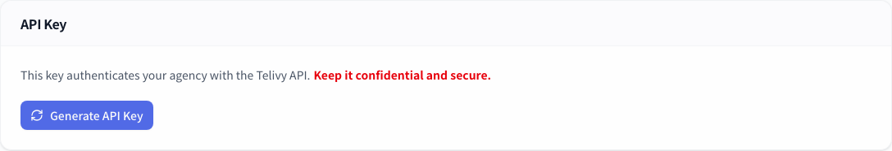

Rewst connects to Telivy through a custom configuration that calls the Telivy Security API with your agency's API key. Once it is set up, Rewst workflows can read and act on your Telivy assessments.

## Set up the Telivy configuration in Rewst

1. In Rewst, create a custom configuration and name it **Telivy**.

   <Frame>
     
   </Frame>
2. Under **Authentication Method**, enter `api-v1.telivy.com` as the **Hostname** and choose **API Key**.

   <Frame>
     
   </Frame>
3. In the Telivy portal, go to **Account → Integrations → API Key** and copy your Telivy API key.

   <Frame>
     
   </Frame>
4. In Rewst, paste the key under **Authentication Details**.

   <Frame>
     
   </Frame>
5. Under **Test Configuration**, set the **Test Action URL Path** to `/api/v1/security/risk-assessments`.

   <Frame>
     
   </Frame>
6. Save, then build your workflows on the new configuration.

   <Frame>
     
   </Frame>

Each agency has one Telivy API key, shared by every integration. Regenerating it in Telivy stops Rewst workflows until you paste the new key into the configuration. The [MCP server overview](/integrations/mcp/overview#get-your-api-key) explains how the key works.
