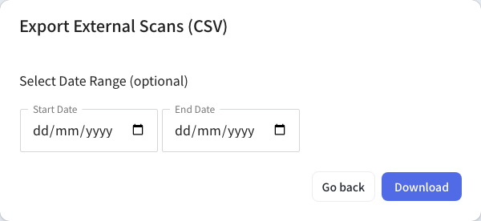

## Create external scans in bulk

To scan many companies at once, start from the **Companies** page. Select the companies, click
**New assessments** in the bulk action bar, and choose **External Scan**. Each selected company
gets its own scan. [Creating assessments in bulk](/getting-started/companies#creating-assessments-in-bulk)
walks through the dialog.

Companies have to exist in Telivy first. To bring them in from your PSA, use
[Importing companies from your PSA](/getting-started/companies#importing-companies-from-your-psa),
which can create the scans in the same flow.

### From a list of domains

For a list of prospects that are not in Telivy or your PSA, create the scans with the
[Security API](/integrations/api). Send one `POST /api/v1/security/external-scans` request per
domain, with `organizationName` and `domain` in the body. A short script or an
[n8n workflow](/integrations/n8n) can read the list from a spreadsheet and send the requests.

## Export findings from all external scans

<Steps>
  <Step title="Open the export">
    On the **Companies** page, open **View** and select **External scans (CSV)** under
    **Export**.
  </Step>
  <Step title="Choose a date range (optional)">
    Set a **Start Date** and **End Date** to export only scans from that period. Leave them
    empty to export every external scan in your account.

    <Frame>
      
    </Frame>
  </Step>
  <Step title="Download">
    Click **Download**. The CSV has the grade for each section and the top 10 findings from
    each section, along with details such as the last scan time.
  </Step>
</Steps>

Questions about bulk scans? Email [support@telivy.com](mailto:support@telivy.com).
