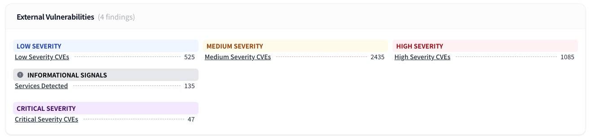
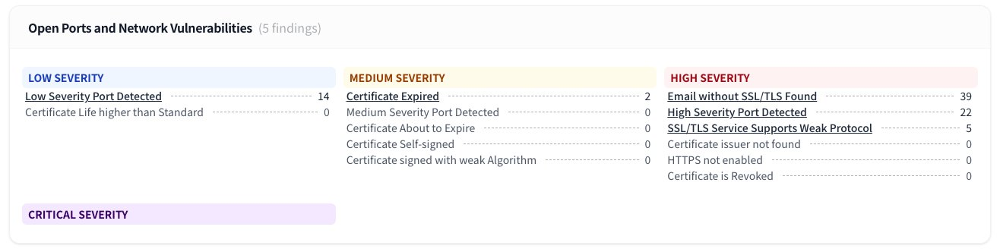

## What an external scan is

An external scan tests a company's public-facing systems for vulnerabilities and
misconfigurations from the outside, the way an attacker would see them. It needs no agent
and no access to the client's network: Telivy only looks at what anyone on the internet can
reach.

To run one, see [Start an External Assessment](/products/external-assessments/start-an-external-assessment). To scan a list of prospects at once, see [Bulk Create and Export External Scans](/products/external-assessments/create-and-export-in-bulk).
The scan reports its findings in these sections:

<Tabs>
  <Tab title="External Vulnerabilities">
    Telivy reads the company's DNS records to find its websites, external IP addresses, and
    other endpoints reachable from the internet, then scans them with a network mapper to
    identify the services running and their known vulnerabilities.

    Each vulnerability is rated Low, Medium, High, or Critical severity, based on its record in the
    National Vulnerability Database (NVD) run by the US government.

    <Frame>
      
    </Frame>
  </Tab>

  <Tab title="Network Security">
    These checks look for weaknesses in how the network is exposed:

    1. **Email Without SSL/TLS** finds mail services that accept unencrypted connections.
       See [Unsecured Emails](/products/external-assessments/unsecured-emails).
    2. **Open Ports** finds open ports and rates each one Low, Medium, or High severity.
       See [Close Open Ports](/products/external-assessments/close-open-ports).
    3. **Certificate checks** look for expired, self-signed, or weak certificates on the
       company's websites. See [SSL/TLS Certificates](/products/external-assessments/ssl-tls-certificates).

    <Frame>
      
    </Frame>
  </Tab>
</Tabs>

## Scanning more than one domain

The scan starts with the domain you entered. To cover other domains, subdomains, or static
IP addresses the company owns, see [Add Domains and IPs](/products/external-assessments/add-domains-and-ips).

## Insurability Score and market cards

The **Overview** tab of an External Assessment has an **Insurability Score** card. Risk
Assessments do not show it. The score is based on the client's answers to the assessment
questionnaire, so until the questionnaire is completed the card is blurred and shows a
**Complete the questionnaire to view this section** link.

### Insurability Score

The gauge shows the client's score from 0 to 100% with a marker for the industry average,
which is set at 50%. A label next to the card title reads **Low** below 20%, **Fair** from
20%, **Good** from 50%, and **High** from 80%.

Telivy tracks which security controls each insurance carrier requires. For every carrier in
the client's addressable market (see below), it works out the share of that carrier's
required controls the client's answers meet, such as multi-factor authentication, offline or
encrypted backups, being able to recover data, and security awareness training. The
Insurability Score is the average of those shares. A higher score means the client meets
more of what carriers ask for. **Learn more** under the score lists the carriers in the
addressable market.

### Addressable Market and Quotable Market

Below the score, two rings count insurance carriers.

| Card | What it shows | How to read it |
| --- | --- | --- |
| **Addressable Market** | Carriers likely to be interested in quoting the client, out of all the carriers Telivy tracks | Carriers are filtered out by prior claims and breaches, industry, and company size. A low number points to the client's profile rather than its security. |
| **Quotable Market** | Carriers in the addressable market whose required controls the client meets in full, out of the addressable market | Each carrier that drops out is missing at least one required control. Fixing the controls behind the score raises this number. |

The **Learn more** link on each ring explains its filters in the product.
