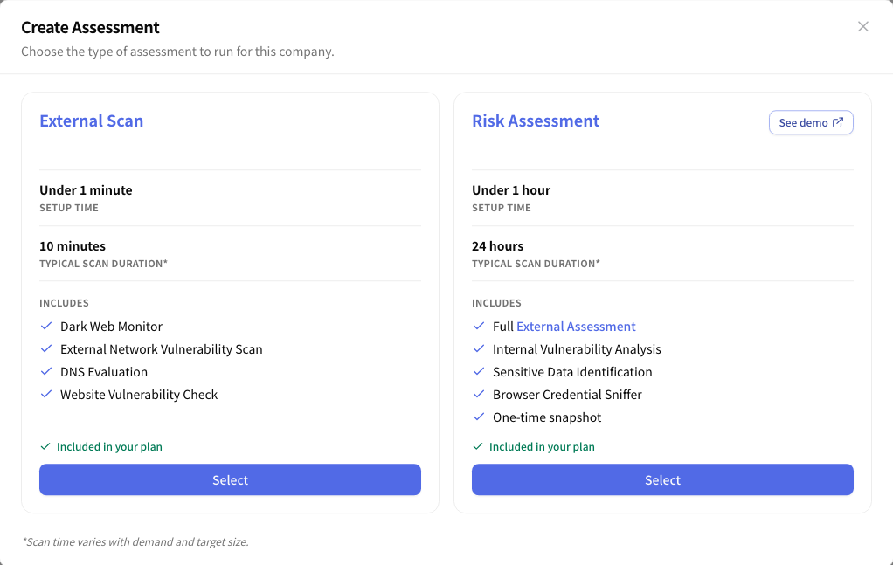

An External Assessment, shown in the portal as an **External Scan**, looks at a company from
the public internet only. Nothing gets installed, so the prospect has nothing to deploy or
approve. Setup takes under a minute and the scan usually finishes in about ten.

It covers the dark web monitor, an external network vulnerability scan, DNS evaluation, and
a website vulnerability check.

## Create the scan

<Steps>
  <Step title="Open the New assessment dialog">
    Click **Create Assessment** in the top right corner of the portal. Telivy opens the
    **Companies** page with the **New assessment** dialog on top. To start from a company you
    already have, open the menu on its row on the **Companies** page and choose **New
    assessment**, which skips the next step.
  </Step>
  <Step title="Pick the company">
    Type in the **Company** search and pick a company listed under **In Telivy**. When a PSA
    is connected, picking a company listed under your PSA imports it into Telivy first. If the
    company is new, choose **Create new company** with the name you typed. A company created
    this way starts as a **Client**.
  </Step>
  <Step title="Select External Scan">
    On the **External Scan** card, click **Select**, then **Continue**. If your account only
    runs external scans, Telivy skips this step.
  </Step>
  <Step title="Fill in the details">
    If the company has no domain on record, enter one under **Domain**. An external scan
    cannot be created without it. **Name (optional)** tells the scan apart from others on
    the same company. When a PSA is connected and the company is linked to it, **Create**
    your PSA **tickets** is on by default and opens tickets for findings according to your
    alert policies.
  </Step>
  <Step title="Create the scan">
    Click **Create external scan**. The scan starts right away, the **Companies** list
    highlights the new assessment under the company, and Telivy emails you when the scan
    completes.
  </Step>
</Steps>

Industries and company status are no longer set in this dialog. Change them with **Edit
company** in the company's row menu on the **Companies** page.

<Note>
  Creating scans for many companies at once? Select their assessments on the **Companies**
  page and choose **New assessments**, or create them right after a PSA import. See
  [Creating assessments in bulk](/getting-started/companies#creating-assessments-in-bulk).
</Note>

## What the assessment cards tell you

Each card shows its setup time, typical scan duration, and what it includes. Above the
**Select** button, it also says whether your plan covers it:

| Card says | Meaning |
| --- | --- |
| Included in your plan | You can create this assessment type now. |
| Not included in your plan | Your plan does not cover this type. Without Unity, use **Contact support to upgrade**. |
| Included with Foundations coverage | Shown on the **Monitored Risk Assessment** card for Cytracom Foundations agencies. |

Agencies that sign in through Unity see a second line under **Not included in your plan**, such as "Available with Assess, billed through Unity", and an action such as **Unlock with Assess** or **Manage in Unity**. [Unity and Cytracom](/getting-started/set-up-telivy-account/unity#what-the-create-assessment-cards-say) lists every variation.

A card your plan doesn't cover has a dashed border and a greyed-out title, so it doesn't
look like an equal choice.

<Frame>
  
</Frame>

Agency admins who sign in through Unity also see a third card, **Monitored Risk Assessment**,
for a Risk Assessment that goes straight onto recurring scans.

## Next steps

<CardGroup cols={2}>
  <Card
    title="Add Domains and IPs"
    icon="plus"
    href="/products/external-assessments/add-domains-and-ips"
  >
    Scan more domains, subdomains, and IP addresses
  </Card>
  <Card
    title="What the scan reports"
    icon="list-check"
    href="/products/external-assessments/overview"
  >
    Open ports, certificates, and unsecured email findings
  </Card>
</CardGroup>
