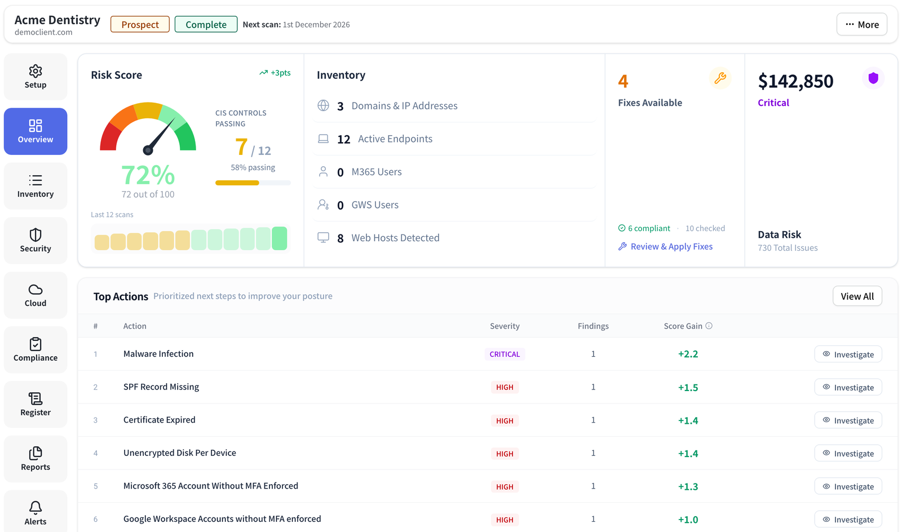

When you open an assessment, the header sits at the top and a tab rail runs down the side.
The tabs you get depend on the assessment type, so an External Scan shows a shorter set
than a Risk Assessment.

<Frame>
  
</Frame>

## The header and the More menu

The header shows the client's name and domain, their client status, the score badge on an
External Scan, and the next scheduled scan once monitoring is on. The action buttons sit on
the right:

- **Convert to Risk Assessment** on an External Scan, to add the agent and cloud scans.
  If your plan doesn't include standalone Risk Assessments, the confirmation dialog says so
  and shows how to upgrade instead of converting.
- **Enable Continuous Monitoring** on a Risk Assessment, or **Monitor Prospect** on an
  External Scan, to put the assessment on recurring scans with trend history. See
  [Risk Monitoring](/products/risk-monitoring/overview).
- **More**, which holds everything else.

The **More** menu contains:

| Item | When you see it |
| --- | --- |
| Edit Name | Always |
| PSA tickets, named after your PSA (for example **HaloPSA tickets**) | When your agency has a PSA connected. Lists every ticket Telivy opened for the assessment. See [grouped PSA tickets](/integrations/psa-grouped-tickets#see-grouped-tickets-in-telivy) |
| Manage Access | Always. See [sharing an assessment](/getting-started/set-up-telivy-account/overview) |
| Risk Scoring Weights | When the assessment is linked to a company. See [adjusting the RPS weights](/scoring/risk-scoring#adjusting-the-rps-weights) |
| Scan Settings | When monitoring is on |
| Device Health Log | When monitoring is on |
| Archive or Unarchive | Always |
| Delete | Only on an archived assessment |

Telivy staff see a few more items in this menu that are used for support.

## The tabs

| Tab | What it is for |
| --- | --- |
| **Setup** | Add domains, deploy the agent, connect Microsoft 365 or Google Workspace, and set up integrations. See [the Setup tab](#the-setup-tab) |
| **Overview** | The headline result: score, top findings, and what changed |
| **Inventory** | What Telivy found: devices, network targets, and installed software. Only on a Risk Assessment. See [Inventory](/products/risk-assessments/inventory) |
| **Security** | The findings, grouped by section, with evidence on each one. See [Network Security](/products/risk-assessments/network-security) |
| **Cloud** | SaaS posture for connected Microsoft 365 and Google Workspace accounts. Only on a Risk Assessment |
| **Company** | Company details and the questionnaire. Only on an External Scan. See [the Company tab](#the-company-tab) |
| **Risk** | Findings grouped by issue, compared between scans, with the Risk Score over time. See [Risk and Priorities](/products/risk-and-priorities) |
| **Priorities** | Every CVE and device across all severities, ranked by [Risk Priority Score](/scoring/risk-scoring#risk-priority-score). See [Risk and Priorities](/products/risk-and-priorities) |
| **Compliance** | Findings mapped to the CIS Critical Security Controls. Only on a Risk Assessment |
| **Register** | Accept and resolve decisions for the assessment's findings. See [Risk Register](/products/risk-register) |
| **Reports** | Generate client-ready reports. See [Reports](/products/reports) |
| **Alerts** | Alerts raised for this client |

A Risk Assessment shows the tabs in this order:

| Position | Tab |
| --- | --- |
| 1 | Setup |
| 2 | Overview |
| 3 | Inventory |
| 4 | Security |
| 5 | Cloud |
| 6 | Risk |
| 7 | Priorities |
| 8 | Compliance |
| 9 | Register |
| 10 | Reports |
| 11 | Alerts |

## The Setup tab

The Setup tab holds everything you configure for an assessment. Its steps differ by
assessment type.

### Setup on a Risk Assessment

A Risk Assessment has five numbered steps, and the tab opens on **2. Deploy Agent**. The
numbers in brackets count what each step already has.

| Step | What it contains |
| --- | --- |
| **1. Manage Domains** | The domains and IP addresses the external scan covers, with **Add Target**. See [Add Domains and IPs](/products/external-assessments/add-domains-and-ips) |
| **2. Deploy Agent** | **Instructions** for installing the agent, and **Deployment Status** for each device, where you also set a device's criticality. See [Install on Windows](/products/risk-assessments/install-telivy-agent-windows), [Install on macOS](/products/risk-assessments/install-telivy-agent-macos), and [setting asset criticality](/scoring/risk-scoring#setting-asset-criticality) |
| **3. Connect Cloud** | Connections to Microsoft 365 and Google Workspace. Until the assessment has a deep scan, the step asks you to deploy the agent first. See [Microsoft 365 Security](/products/risk-assessments/microsoft-365-security) and [Google Workspace Security](/products/risk-assessments/google-workspace-security) |
| **4. Integrations** | The PSA card, plus the Unity, Tentacle, and pen testing tiles described in [Integrations step](#integrations-step) |
| **5. Optional Steps** | **Dark Web Email List**, **Connect Nodeware**, and **Remove Telivy**, described in [Optional Steps](#optional-steps) |

### Setup on an External Scan

An External Scan has two views on its Setup tab:

| View | What it contains |
| --- | --- |
| **Manage Domains and IP Addresses** | The domains and IP addresses the scan covers, with **Add Target**. It appears once the first scan exists. See [Add Domains and IPs](/products/external-assessments/add-domains-and-ips) |
| **Integrations** | The same cards as the Integrations step of a Risk Assessment, described in [Integrations step](#integrations-step) |

The tab opens on **Manage Domains and IP Addresses**, or on **Integrations** before the first
scan exists.

### Integrations step

The **Integrations** section always has a PSA card. If your agency has no PSA connected, the
card is **Connect a PSA**, which takes you to Account Settings to connect ConnectWise,
Autotask, or HaloPSA. Once a PSA is connected, the card is named after it and shows whether
this company is **Mapped** or **Not mapped** to a company in the PSA. Use the **Map** button to create
the mapping, and **Change mapping** or **Unmap** to change it. The **Sync findings to PSA**
switch turns ticket creation on for the assessment's findings; if sync is on but the company is
not mapped, the card warns that no tickets will be created. For ConnectWise and HaloPSA, the
**Check for updates** button (it includes the PSA's name, for example **Check HaloPSA for
updates**) looks for resolved tickets straight away instead of waiting for the hourly check. See [Integrations](/integrations/overview) for each PSA.

Unity users also see a **Unity** tile in the Integrations section and a **Compliance** section
with a **Tentacle** tile. See [Unity](/getting-started/set-up-telivy-account/unity) and
[Tentacle](/integrations/tentacle). A **Services** section with the **Telivy + HDS
PenTesting** tile, used to request a pen test, appears unless your account is white-labelled.

### Optional Steps

| Item | What it is for |
| --- | --- |
| **Dark Web Email List** | Upload a CSV of extra email addresses, such as contractors, to include in the assessment |
| **Connect Nodeware** | Link the client's Nodeware customer ID. Only when Nodeware is enabled for your account. See [Nodeware](/integrations/nodeware) |
| **Remove Telivy** | Commands to uninstall the agent. See [Uninstall on Windows](/products/risk-assessments/uninstall-telivy-agent-windows) and [Uninstall on macOS](/products/risk-assessments/uninstall-telivy-agent-macos) |

## The Cloud tab

Cloud is only on Risk Assessments. An External Scan has no agent and no cloud connection to
read from, so it has no Cloud tab.

A switch at the top picks the provider, Microsoft 365 or Google Workspace. Under Microsoft 365
the tab has two sections:

- **Identity / Entra ID**, with **Signals & Inventory** for MFA coverage, accounts, and sign-in
  activity, and **Risk Insights** for Secure Score controls raised as findings
- **Policy Management**, for the policy baseline and where the tenant drifts from it

Google Workspace shows the same posture view for a connected Workspace domain. See
[Microsoft 365 security](/products/risk-assessments/microsoft-365-security) for what each
section contains.

An empty tab means nothing is connected yet. Connect an account under
**Setup > Connect Cloud** and the views appear after the next data refresh.

<CardGroup cols={2}>
  <Card
    title="Microsoft 365 Security"
    icon="microsoft"
    href="/products/risk-assessments/microsoft-365-security"
  >
    Connecting M365 and reading the results
  </Card>
  <Card
    title="Google Workspace Security"
    icon="google"
    href="/products/risk-assessments/google-workspace-security"
  >
    Connecting Workspace and reading the results
  </Card>
</CardGroup>

## Tabs on an External Scan

An External Scan has no endpoints, so it has no Inventory, Cloud, or Compliance tab, and it
adds a Company tab. Its tabs appear in this order:

| Position | Tab |
| --- | --- |
| 1 | Setup |
| 2 | Overview |
| 3 | Security |
| 4 | Company |
| 5 | Risk |
| 6 | Priorities |
| 7 | Register |
| 8 | Reports |
| 9 | Alerts |

## The Company tab

The Company tab on an External Scan has two views and opens on **Details**.

| View | What it contains |
| --- | --- |
| **Details** | The **Company Details** table with the company name, domain, status, category, and antivirus |
| **Questionnaire** | The questionnaire answers for the assessment, which you can page through, edit and save, share, or export |
