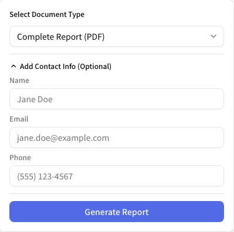

Every assessment has a **Reports** tab. You generate client-facing reports there, and it
keeps the earlier versions of each one.

## Generating a report

<Steps>
  <Step title="Open the report picker">
    In the assessment, open **Reports** and click **Generate New Report**.
  </Step>
  <Step title="Choose a report type">
    Pick the report from the list. You can type to search it.
  </Step>
  <Step title="Add contact details (Complete Report only)">
    For the **Complete Report (PDF)**, expand **Add Contact Info (Optional)** and enter the
    name, email, and phone number the client should contact about the report.
  </Step>
  <Step title="Generate">
    Click **Generate Report**. The new version appears at the top of the reports table.
    <Frame>
      
    </Frame>
  </Step>
</Steps>

To refresh every report at once, use **Generate All Reports** in the same picker. It takes a
snapshot of what the Security tab currently shows, rebuilds each report, and packages them
into a ZIP file. Telivy emails you when the reports are ready.

## Building a custom report

<Note>
  Custom reports are in Beta, and the button and builder carry a **Beta** badge.
</Note>

A custom report is a PDF whose sections, order, and look you choose yourself. You build it from a template, and you can reuse that template for other assessments.

<Steps>
  <Step title="Open the builder">
    In the assessment, open **Reports** and click **Create Custom Report**.
  </Step>
  <Step title="Pick a starting point">
    Choose **Blank report** to pick every section yourself, or start from a template. Templates are grouped as **Telivy templates**, **Your templates**, and **Shared by your parent agency**. Telivy templates and templates shared by a parent agency are read only, so select **Duplicate to edit** to make your own copy.
  </Step>
  <Step title="Edit the template">
    The builder shows a live preview next to three tabs. On **Sections**, add sections from the section library with **Add section**, drag them into order, and open a section to change its settings. The **Table rows in this report** meter shows how many table rows the report uses against its limit. On **Theme**, set the primary and accent colours, font, cover layout, logo and cover image URLs, footer text, and a confidentiality label. If you leave the logo URL empty, the report uses your agency logo. On **Details**, set the template name, which is printed as the report title on the cover, and a description, which is not printed.
  </Step>
  <Step title="Save and generate">
    Click **Save**, or **Save as new** to keep the original template unchanged. **Generate PDF** is only available once the template is saved with no unsaved changes. In the dialog, choose the template and optionally add who the report is **Prepared for** and a contact name, email, and phone number. The PDF is built in the background, and you can close the dialog while it runs. When it finishes, the report is listed under **Reports**.
  </Step>
</Steps>

The template menu next to **Generate PDF** lets you duplicate or delete a template.

## Which reports are available

The list depends on the assessment type, because most reports need data that an External
Scan never collects.

### From an External Scan

- External Scan Executive Report (PDF)
- External Scan Detailed Report (PDF)
- Questionnaire Report (PDF)
- Progress Report (PDF and DOCX)

### From a Risk Assessment

All of the External Scan reports, plus the ones built on agent and cloud data:

| Report | Format |
| --- | --- |
| Complete Report | PDF |
| Legacy Complete Report | PDF |
| Executive Summary | PDF |
| Vulnerabilities Report | CSV |
| Internal Vulnerabilities Executive Report | PDF |
| Internal Vulnerabilities Network Report | PDF |
| Top Internal Vulnerabilities Report | PDF |
| Passwords Report | CSV |
| Passwords Reuse Report | CSV |
| Dark Web Data Report | CSV |
| Network Inventory Report | CSV |
| Applications Security Overview Report | CSV |
| Applications Security Detailed Report | CSV |
| Data Security Sensitive Documents Report | CSV |
| Data Security Detailed Risk Report | XLSX |
| Microsoft 365 Security Report | PDF |
| Microsoft 365 Security Data Report | XLSX |
| Google Workspace Security Report | PDF |
| Google Workspace Security Data Report | XLSX |

The **Vulnerabilities Report** is a single CSV file. For a spreadsheet split by view, open the **Threats & Vulns** view under the assessment's **Security** tab and click **Export All (XLSX)**. That file has one sheet each for **By CVE**, **By Device**, **By User**, and **By Patch**.

<Note>
  **Executive Summary (PDF)** only appears once the assessment has an AI-generated executive
  summary. If it isn't in the list, the summary hasn't been produced yet.
</Note>

## What the Complete Report contains

The Complete Report is the full cyber security risk assessment (CSRA) for a client. Its
table of contents is built from the data available, so a section with nothing to say is
left out. In order, it can contain:

1. CSRA Methodology
2. Executive Summary, when the assessment has an AI summary
3. Progress Since Last Assessment, when there is an earlier assessment to compare with
4. Overview
5. Data Breach Cost Breakdown, when a breach cost estimate is available
6. One section per CIS control category, with the controls in it
7. Detailed Recommendations
8. Top Remediation Actions
9. Top Critical Assets & Why
10. Strategic & Operational Priorities
11. Addendums

**Progress Since Last Assessment** shows whether the client's posture is **Improving**,
**Stable**, or **Declining**, a short narrative, how many findings were resolved and how
many are new since the previous assessment, and a list of specific changes labelled
**Resolved**, **New**, **Risk Reduction**, or **Compliance**. The trend and counts come from
the finding history itself, and any AI-written statement that contradicts those counts is
left out.

## What the Executive Summary contains

The **Executive Summary (PDF)** is the short version for people who won't read the full
report. It covers issue severity, the score with a summary, CIS compliance, key findings,
suggested actions, strategic and operational priorities, and next steps. Pages without data
are skipped.

## Peer benchmarks on the Overview

The **Executive Summary** card on a Risk Assessment's Overview, and the **External Surface Exposure** card on an External Scan, compare the client with other companies Telivy has assessed. Each category on the Executive Summary card shows the client's score, the typical score, and whether the client is **Above**, **Below**, or **In line** with it, for example "You 72% · Typical 65% · Above". The typical score is the median across the peer group.

By default the peer group is all assessments. To compare with similar companies, choose a sector from the dropdown under the card. The comparison only switches to a sector once that sector has at least 20 assessed companies. Until then, the card says there are not enough companies in that sector yet and keeps comparing with all assessments.

## Report versions

The reports table has one row per report type, with **Last Generated At** and the number of
**Versions**. Click a row, or **Expand All**, to see every version with its file name and
generation time. **Download Latest Version** in the row's **Actions** menu downloads the
newest copy.

## Which report to send

For a prospect who hasn't bought anything yet, send the External Scan Executive Report. It
is short and needs no agent. Once they're a client and the first full scan is done, send the
Complete Report, and add the Executive Summary for readers who won't get through the full
report.

For monitoring reviews, send the Progress Report, which shows what changed since the last
scan instead of restating the whole posture. The Complete Report also carries a progress
section once there is an earlier assessment. When you're talking to the client's IT team,
send the CSV exports, which are meant for a spreadsheet.

<CardGroup cols={2}>
  <Card
    title="Understand the scoring"
    icon="gauge-high"
    href="/scoring/risk-scoring"
  >
    What the score in the report measures
  </Card>
  <Card
    title="Report grading criteria"
    icon="clipboard-check"
    href="/scoring/grading-criteria"
  >
    How each section of the report earns its grade
  </Card>
</CardGroup>
