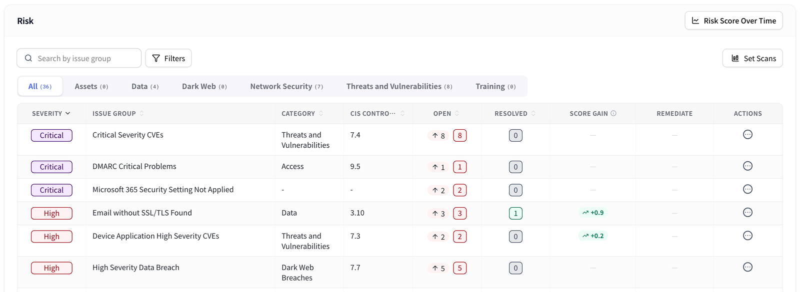
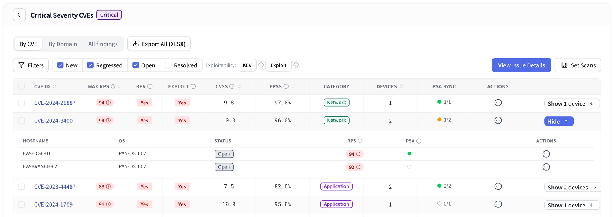
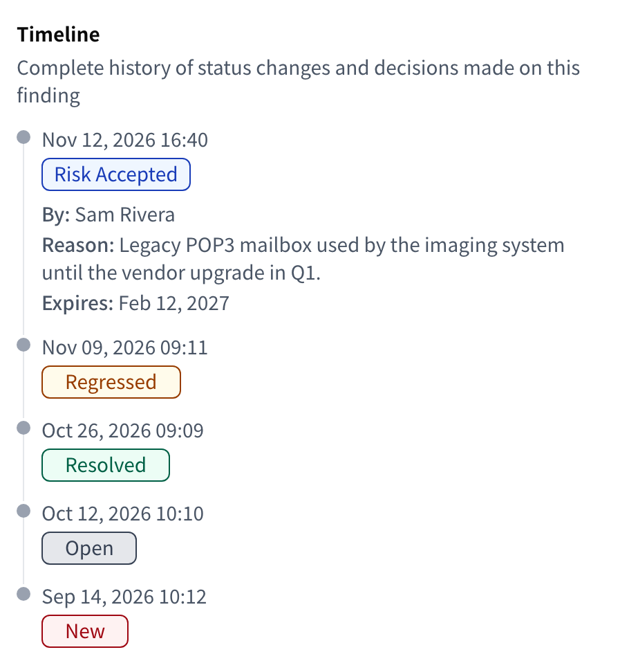
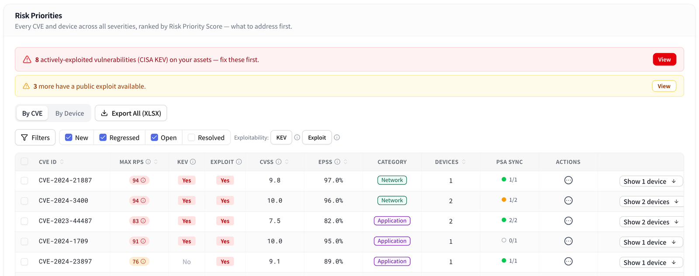

Every assessment, Risk Assessment or External Scan, has a **Risk** tab and a **Priorities**
tab. The Risk tab lists the assessment's findings grouped by issue, shows how each group
changed between two scans, and is where you open individual findings to accept, resolve, or
ticket them. The Priorities tab ranks every vulnerability (CVE) and every affected device
across all severities by [Risk Priority Score](/scoring/risk-scoring#risk-priority-score)
(RPS), so you can see what to fix first.

## The Risk tab

### Risk Score Over Time

The **Risk Score Over Time** button at the top of the tab opens a chart of the assessment's
Risk Score across its recent scans. Hovering over a point shows the score for that scan with
the number of new, resolved, regressed, and open findings, each compared with the scan before.
The button only appears once the assessment has more than one scan in its history. See
[score history](/scoring/risk-scoring#score-history) for how the score is tracked.

### The issue group list

The tab opens on a list of issue groups, such as a type of misconfiguration or a set of
vulnerabilities. It is sorted by severity, highest first.

| Column | What it shows |
| --- | --- |
| Severity | Critical, High, Medium, Low, or Info |
| Issue Group | The name of the issue. **Fix Available** marks groups that Telivy can fix automatically |
| Category | The CIS category the group belongs to |
| CIS Control ID | The CIS control the group maps to |
| Open | Findings still open, with the number that are new or regressed next to an up arrow |
| Resolved | Findings resolved since the comparison scan |
| Score Gain | The points the security score would gain if the group were fixed. Only shown when Telivy has a projection |
| Remediate | **Remediate** or **Fix** when Telivy can apply a fix for the group, otherwise a dash |
| Actions | **Create Tasks** and **View More**, which opens the group |

Above the list you can search by issue group name, filter by severity in the filters menu,
and narrow the list to one category with the pills: **All**, **Assets**, **Data**, **Dark
Web**, **Network Security**, **Threats and Vulnerabilities**, and **Training**.

<Frame>
  
</Frame>

### Comparing scans

When the assessment has more than one scan, **Set Scans** picks which two scans the counts
compare. **As of** is the scan you are looking at, and **Compared to** is the earlier scan it
is measured against. By default these are the latest scan and the one before it.

### Inside an issue group

Click a row to open the group. The heading shows the group's name, severity, and CIS control,
and the back arrow returns to the list.

For most groups, the page lists every finding in the group. A status filter shows **New**,
**Regressed**, and **Open** findings by default; tick **Resolved** to include resolved ones.
Tick the findings you want and click **Accept/Resolve** to record a decision for all of them,
or use **Accept/Resolve** in a row's action menu for one finding. The decision is recorded in
the [Risk Register](/products/risk-register).

Vulnerability groups open with three views instead:

| View | What it lists |
| --- | --- |
| **By CVE** | One row per CVE, ranked by RPS. Expand a row to see each affected device, domain, or asset |
| **By Device** | One row per affected device with its CVE count and highest scores. The view is called **By Domain** or **By Asset** when the vulnerabilities are on domains or other assets |
| **All findings** | Every individual finding in the group, with the same status filter and Accept/Resolve controls as other groups |

In **By CVE** and **By Device**, you can filter by device (or domain or asset), by CVE, and by
severity, and search. **By CVE** also has **Exploitability** filters for **KEV** and
**Exploit**. **Export All (XLSX)** downloads the assessment's vulnerabilities as a
spreadsheet. Each row's action menu has **Accept/Resolve**, which applies the decision to every
finding in that row.

### The PSA column

When findings for the assessment are synced to a PSA, the finding tables get a **PSA** column
with a status dot per finding. The dot shows whether the finding has a ticket in your PSA.
Clicking a dot syncs that finding now, or opens its existing ticket. In **By CVE** and **By
Device**, a **PSA Sync** column shows how many of the row's findings are synced.

<Frame>
  
</Frame>

With sync on, you can also tick findings and use **Sync to** followed by your PSA's name to
open tickets for the ones not yet synced, and the issue group list shows **Find unsynced in**
followed by your PSA's name, which counts what a sync would open before you confirm it. See
[PSA integrations](/integrations/overview) for setting up sync, and
[Grouped PSA tickets](/integrations/psa-grouped-tickets) for how findings are grouped into
tickets.

### The finding drawer

Click a finding to open its details in a drawer on the right. It shows:

- A summary with the risk level, impact, CIS compliance status, the identifier (such as the
  device or domain), and the detected value
- The finding's PSA ticket, when sync is on
- For a vulnerability, the CVE with its CVSS score, exploit, KEV and EPSS signals, publish
  date, and where it was found, followed by remediation guidance, affected products, and the
  version that fixes it
- The recommendation, CIS control requirements, and references
- A **Timeline** with every status change and every decision made on the finding, with who
  made it, the reason, and when it expires

The current decision in the timeline can be edited or deleted from its pencil and bin icons.

<Frame>
  
</Frame>

## The Priorities tab

The **Priorities** tab, titled **Risk Priorities**, lists every CVE and every affected device in
the assessment across all severities, ranked by RPS with the highest first. It shows the
latest scan only, and it has two views: **By CVE** and **By Device** (or **By Domain** or **By
Asset**, depending on what the vulnerabilities affect). There is no **All findings** view.

When any CVE on the assessment is in the CISA Known Exploited Vulnerabilities (KEV) catalog, a
red banner at the top gives the count, and an amber banner counts the CVEs that have a public
exploit but are not in KEV. **View** on either banner switches to **By CVE** filtered to those
CVEs.

<Frame>
  
</Frame>

### By CVE

| Column | What it shows |
| --- | --- |
| CVE ID | The CVE. Click it to open the finding drawer |
| Max RPS | The highest RPS among the devices or assets the CVE affects. Hover for the band and reason, or select it for the breakdown |
| KEV | **Yes** when CISA has confirmed the CVE is exploited in the wild |
| Exploit | **Yes** when public exploit or proof-of-concept code is listed in Exploit Database |
| CVSS | Technical severity, from 0 to 10 |
| EPSS | The estimated probability that the CVE is exploited in the next 30 days |
| Category | The kind of component the CVE affects |
| Devices | How many devices (or domains or assets) the CVE affects. Expand the row to list them with their own RPS |
| PSA Sync | How many of the CVE's findings are synced to your PSA, when sync is on |
| Actions | **Accept/Resolve** for every finding of the CVE |

### By Device

| Column | What it shows |
| --- | --- |
| Hostname | The device. The column is **Domain** or **Asset** for other kinds of target |
| OS | The device's operating system. Devices only |
| Total CVEs | How many CVEs affect the device |
| Max RPS | The highest RPS among the device's CVEs |
| Max CVSS | The highest CVSS among the device's CVEs |
| Max EPSS | The highest EPSS among the device's CVEs |
| Asset Criticality | How important Telivy estimates the device is, mainly from the personal data found on it. Devices only |
| PII Exposure | Personal data found on the device. Devices only |
| PSA Sync | How many of the device's findings are synced to your PSA, when sync is on |
| Actions | **Accept/Resolve** for every CVE finding on the device |

Both views are sorted by RPS by default, 25 rows per page, and can be filtered, searched, and
exported in the same way as the vulnerability views on the Risk tab. Hover over the
information icon next to KEV, Exploit, CVSS, EPSS, or Asset Criticality for a short
explanation of the signal. To change a device's criticality or the weights behind the RPS, see
[Setting asset criticality](/scoring/risk-scoring#setting-asset-criticality) and
[Adjusting the RPS weights](/scoring/risk-scoring#adjusting-the-rps-weights).

## Related guides

<CardGroup cols={2}>
  <Card title="Risk Score" icon="gauge-high" href="/scoring/risk-scoring">
    How the Risk Score and the Risk Priority Score are calculated
  </Card>
  <Card title="Risk Register" icon="scroll" href="/products/risk-register">
    Where accept and resolve decisions are recorded and reviewed
  </Card>
  <Card title="Integrations" icon="ticket" href="/integrations/overview">
    Connect a PSA so findings open service tickets
  </Card>
  <Card title="Navigating an Assessment" icon="compass" href="/products/navigating-an-assessment">
    What each tab of an assessment is for
  </Card>
</CardGroup>
