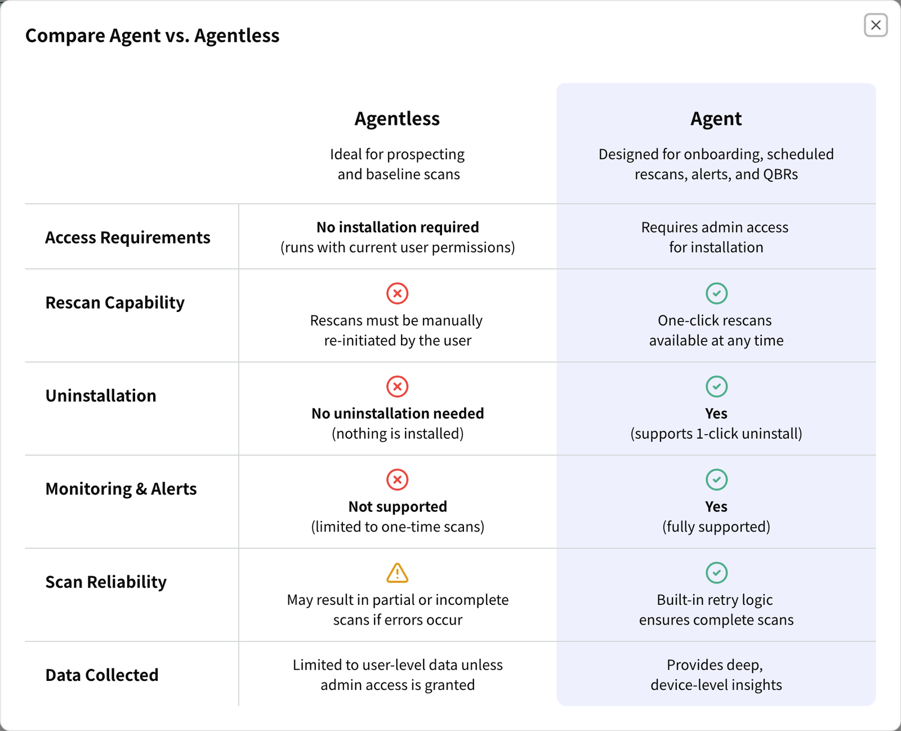
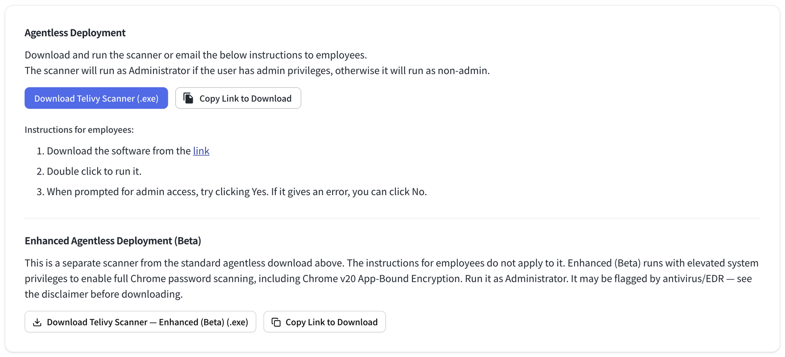

Telivy collects data from Windows and macOS devices in one of two ways. The **agent** installs
on the device, stays there, and keeps scanning on a schedule. The **agentless scanner** runs
once, leaves nothing installed, and gives you a one-time snapshot.

Pick the mode on the assessment's **Setup** tab under **Deploy Agent > Instructions**, with the
**Agent** and **Agentless** switch. **Compare Agent vs. Agentless** next to the switch opens the
same comparison as the table below.

<Frame>
  
</Frame>

| | Agentless | Agent |
| --- | --- | --- |
| Best for | Prospecting and baseline scans | Onboarding, scheduled rescans, alerts, and QBRs |
| Access | Nothing to install. Runs with the current user's permissions | Needs admin access to install |
| Rescans | The user has to run the scanner again | One-click rescans from the portal at any time |
| Uninstall | Nothing to uninstall | One-click uninstall from the portal |
| Monitoring and alerts | Not supported. One-time scans only | Supported |
| Scan reliability | Errors can leave a partial or incomplete scan | Built-in retries complete the scan |
| Data collected | User-level data, unless the user grants admin access | Deep, device-level data |

A standard-user agentless scan only sees what that user can open, so PII and password coverage
is narrower than with the agent.

## How agentless devices show up

On the assessment's **Inventory > Endpoints** page and under **Deployment Status**, a device
scanned without the agent shows an **Agentless Scan** badge, and its agent status reads "Not
installed, scanned agentlessly". The device cannot be rescanned or uninstalled from the portal.
If no device in the assessment has an online agent, **Rescan All** and **Uninstall All** are
disabled.

The agentless scanner still completes when an EDR such as ThreatLocker blocks the agent
installer, which is the usual reason a device you meant to install the agent on shows up as
agentless. Allow Telivy first, then run the agent installer again.

## Enhanced Agentless Deployment (Beta) on Windows

On Windows, the **Agentless** instructions include a second scanner under **Enhanced Agentless
Deployment (Beta)**. It is a separate download from the standard agentless scanner, and the
instructions for employees do not apply to it.

The enhanced scanner runs with elevated system privileges so it can scan Chrome passwords in
full, including passwords protected by Chrome's App-Bound Encryption (Chrome v20). This gives
much more complete password coverage than the standard agentless scanner. Run it as
Administrator.

Select the **Download Telivy Scanner, Enhanced (Beta)** button or the **Copy Link to Download**
button next to it. A dialog
explains the scanner first, and you confirm with **I understand, download** or **I understand,
copy link**.

<Frame>
  
</Frame>

<Warning>
  While it runs, the enhanced scanner creates a temporary SYSTEM-level scheduled task and runs
  from `C:\ProgramData\Telivy\Runner\`. Antivirus and EDR products such as CrowdStrike,
  SentinelOne, Microsoft Defender for Endpoint, or ThreatLocker may flag or block it on
  hardened systems. If your endpoint security blocks it, add a path exclusion for
  `C:\ProgramData\Telivy\Runner\` or ask your security team. You can always fall back to the
  standard agentless scanner.
</Warning>

This scanner is in beta. Report problems to [support@telivy.com](mailto:support@telivy.com).

## Install guides

<CardGroup cols={2}>
  <Card title="Install on Windows" icon="windows" href="/products/risk-assessments/install-telivy-agent-windows">
    RMM command, installer, or agentless scanner
  </Card>
  <Card title="Install on macOS" icon="apple" href="/products/risk-assessments/install-telivy-agent-macos">
    RMM or MDM command, installer, or agentless scanner
  </Card>
</CardGroup>
