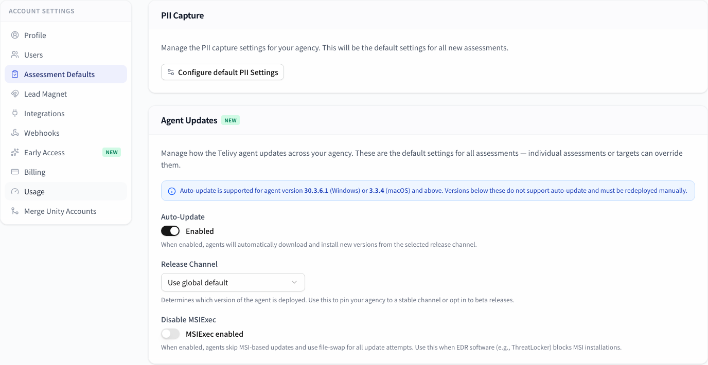
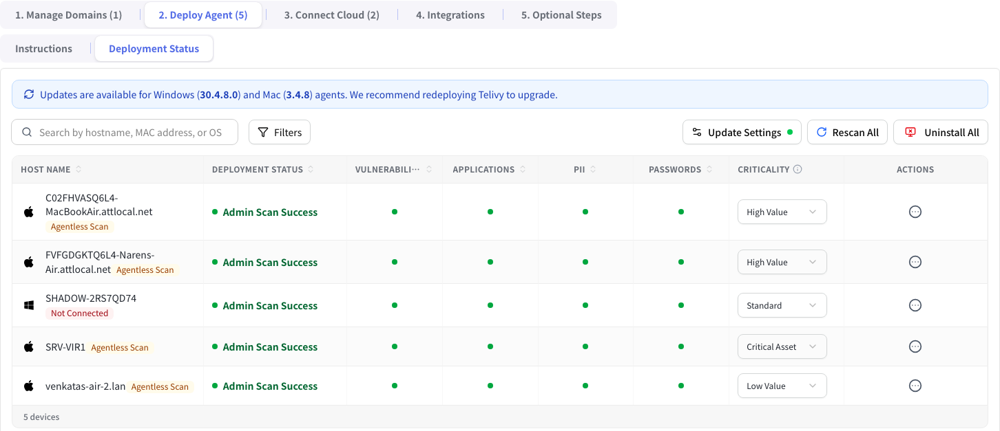
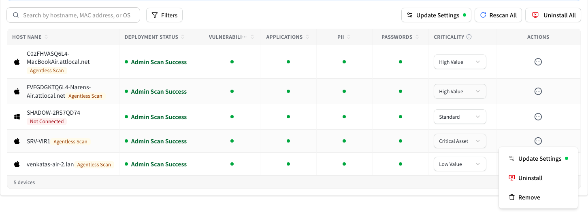

With auto-update on, the Telivy agent upgrades itself when a new version is released, so you do not have to redeploy it across every client.

## How auto-update works

On each hourly check-in, before starting the scanner, the agent checks the update manifest. If an update is available, the system:

1. Downloads the MSI (Windows) or PKG (macOS) update.
2. Runs validation: hash check, certificate verification, and installer size.
3. Creates update metadata and launches the installer upgrade.
4. Shuts down the agent, completes the upgrade, and restarts it.
5. On restart, the agent detects the previous update metadata and sends a final confirmation that the update succeeded.

If the update fails, the agent sends the error and its log to Telivy and tries again, up to **3 times** in total. After that it stops trying and keeps running its current version.

## Configuring auto-update

You can set auto-update at three levels. A more specific setting overrides a broader one:

| Level | Priority | Scope |
| --- | --- | --- |
| Account | #3 (lowest) | Applies to all assessments and machines |
| Assessment | #2 | Overrides account settings for all machines in the assessment |
| Machine | #1 (highest) | Overrides both account and assessment settings for a specific machine |

Telivy uses the most specific setting it finds. If auto-update is on for an assessment, every machine in it updates unless the machine has its own setting.

### Account level

Go to **Account > Assessment Defaults** (`https://portal.telivy.com/agent/account/assessments`) and find the **Agent Updates** card.

<Frame>
  
</Frame>

Turn on the switch and choose a **Release Channel**. Use **Stable** at the account level.

### Assessment level

Open the assessment and go to **Setup > Deploy Agent > Deployment Status**.

<Frame>
  
</Frame>

Select **Update Settings** to open the assessment's update settings and override the account setting for this assessment.

<Frame>
  
</Frame>

<Note>
  Auto-update needs agent version **30.3.6.1** or later on Windows and **3.3.0** or later on macOS. Older agents have to be redeployed by hand.
</Note>

When an assessment is created with ThreatLocker as its antivirus, Telivy turns auto-update off for it, because ThreatLocker blocks MSI-based updates. You can turn it back on here.

Tick **Override account setting** to turn auto-update on or off for this assessment. The dialog shows what it inherits, for example "Currently **enabled** (inherited from account)". Tick **Override global default setting** to pick a different release channel.

### Machine level

In **Setup > Deploy Agent > Deployment Status**, open the **Actions** menu for a machine.

<Frame>
  
</Frame>

Select **Update Settings** to override the account and assessment settings for that machine.

<Frame>
  
</Frame>

Tick **Override account setting** to turn auto-update on or off for this machine, or **Override assessment setting** to give it a different release channel. The dialog shows the inherited values, for example "Currently using **Beta** channel (inherited from assessment)".

## Checking which devices are up to date

The **Deployment Status** table under **Setup > Deploy Agent** shows an agent status badge on each device. Hover over the badge to see the installed version, the version it should be on, and the reason for its state.

| Status | What it means |
| --- | --- |
| Agent Installed | The agent is on the current version. |
| Updating to *version* | The agent is behind and will update itself, usually within an hour of being online. |
| Update Failing | The last automatic update failed and the agent keeps retrying, or an update started more than a day ago and has not finished. |
| Auto-update Off | The agent is behind and automatic updates are turned off in **Update Settings**. Turn them on or redeploy the agent. |
| Reinstall Required | The agent cannot update itself and has to be redeployed by hand. This happens when the installed version predates automatic updates, when it cannot update directly to the current release, or when automatic updates failed three times and stopped. |
| Not Connected | The agent has not checked in for more than 3 days. The tooltip also shows its update state if it is behind. |

When some devices run an older agent than the current release, a banner above the table says how many there are, how many will update automatically, and how many need your attention. **Show these devices** filters the table to those devices. You can apply the same filters from **Device Status**: **Update Required** lists every device that is behind, and **Needs Attention** lists devices that are **Update Failing**, **Auto-update Off**, or **Reinstall Required**.

## Release channels

| Channel | Purpose |
| --- | --- |
| Stable | Production releases. Use this for client environments. |
| Beta | Pre-release versions for early testing |

## Examples

| Goal | Setup |
| --- | --- |
| Auto-update every client | Turn on auto-update at the account level with the Stable channel. Every assessment and machine inherits it. |
| Try Beta on one assessment | Keep the account on Stable and override the release channel to Beta on that assessment. Only its machines get beta updates. |
| Try Beta on a few machines | Keep the account on Stable and override the release channel to Beta on those machines. |
| Keep one machine off auto-update | Leave auto-update on at the account or assessment level and override that machine's auto-update to off. |

## FAQ

<AccordionGroup>
  <Accordion title="What happens if an update fails?">
    The agent sends the error log to Telivy and retries, up to 3 attempts in total. If every attempt fails, it keeps running its current version.
  </Accordion>

  <Accordion title="Do I need to uninstall the old agent before updating?">
    No. Auto-update upgrades the agent in place.
  </Accordion>

  <Accordion title="Which agent versions support auto-update?">
    Windows **30.3.6.1** and macOS **3.3.0** or later. Older agents have to be redeployed with a current installer.
  </Accordion>

  <Accordion title="How often does the agent check for updates?">
    Every hour, on the same check-in where it sends its heartbeat and picks up pending instructions. [Scanning Schedule](/products/risk-monitoring/scanning-schedule) lists what else runs on that cycle.
  </Accordion>

  <Accordion title="Can I mix Stable and Beta?">
    Yes. Keep the account on Stable and set Beta on one assessment or on individual machines.
  </Accordion>
</AccordionGroup>
