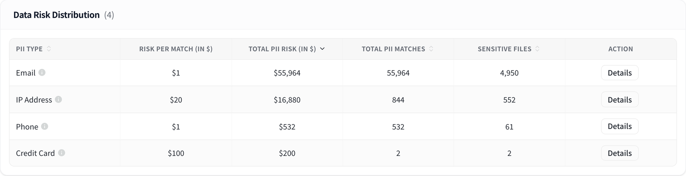

Data Security is the part of a Risk Assessment that looks for personally identifiable information (PII) stored on a client's devices and puts a dollar figure on it. If a client has HIPAA or other privacy requirements, read the section on masking before you scan.

## How PII detection works

During each scan the Telivy agent reads files on the endpoint and looks for content that matches known PII patterns. For every file with matches, Telivy records the device, the file path, the PII type, how many matches it found, a confidence level, and a dollar-risk value based on a cost per match. Results roll up per device and per client, so you can see which machines hold the most exposure.

## Requirements

- A **Risk Assessment**. External Assessments do not scan for PII.
- The Telivy agent on the devices you want scanned. The agent scans with system privileges and can read every file on the device. You can also scan without installing the agent, but then the scan runs as the signed-in user and only sees files that user can open.

## PII types by country

Each assessment has a PII country, and the country decides which PII types are scanned for and how they are labeled. Telivy supports the United States, Canada, the United Kingdom, South Africa, Australia, New Zealand, Singapore, and Poland.

Every country includes credit card numbers, phone numbers, email addresses, IP addresses, OAuth tokens, bank SWIFT codes, and passport numbers. On top of that, each country adds its own identifiers:

| Country | National ID | Health ID | Other |
| --- | --- | --- | --- |
| United States | SSN | Medical Record | Date of Birth, Bank Routing Number, Bank IBAN Code |
| Canada | SIN | Personal Health Number | Date of Birth, Bank Routing Number |
| United Kingdom | National Insurance Number | NHS Number | Date of Birth, Bank IBAN Code |
| South Africa | South Africa ID | | Date of Birth, Bank Routing Number |
| Australia | Tax File Number | Medicare Card Number | Date of Birth |
| New Zealand | IRD Number | Health Index Number | Date of Birth |
| Singapore | NRI Number | | Driver License |
| Poland | PESEL | | Driver License |

## Reading the results

Open **Inventory > Data**, or the Data Security section of the **Security** tab, and select a device to open its data risk table. It lists one row per file with these columns: **Status**, **Device**, **File**, **Size**, **Last Modified**, **PII Type**, **Confidence**, **Matches**, and **Risk** in the assessment's currency. The table shows how many matches a file has, never the matched values themselves.

You can search by file path and filter by PII type, status, and confidence. Confidence is **High**, **Medium**, or **Low**. A match scores higher when, for example, it passes a checksum or has a context keyword such as "SSN" near it.

Select **View** on a row to open the file details. This shows the file path, match count, confidence, the detection signals behind that confidence, and a **Data Found** section with the matched values. Use it to confirm whether a hit is real or a false positive, such as a test card number in a code sample.

If a file is a false positive, select **Mark False**. Its status changes to **False Positive** and its dollar risk drops to zero. **Unmark False** reverses it.

The CSV PII report includes match counts by PII type for the same files.

## What leaves the device

By default, Telivy keeps a sample of each matched value along with the file path, device, and PII type, because confirming a finding requires seeing what was matched. The data flow is:

1. The agent scans files locally on the endpoint.
2. Matches are encrypted in an application-level payload before they are sent, in addition to TLS.
3. The Telivy platform decrypts the payload and stores it against the device.
4. Only users with access to the assessment can see it in the portal.

Passwords are handled differently. The password analysis never sends cleartext passwords off the device, only hashes. If storing PII samples is not acceptable for a client, turn on masking.

## Mask PII Data

The **Mask PII Data (may be required under HIPAA)** setting removes matched values from the **Data Found** view, from CSV exports, and from anywhere else a raw match would appear. Match counts, file paths, devices, and dollar risk are still shown, so you can still act on the finding.

Turn it on for clients that handle protected health information or whose vendor risk program does not allow a third party to store production PII. Some agencies turn it on for every client so there is one policy to explain.

### Where to set it

PII settings live in a dialog called **Configure PII Settings**. You can open it in two places:

- **For one assessment:** select **Configure PII Settings** in the Data Security section of the **Security** tab, or on the **Financial Exposure** card on the **Overview** tab. The Overview button is only shown to account admins.
- **As your agency default:** go to **Account > Assessment Defaults**, find the **PII Capture** card, and select **Edit PII defaults**. Only account admins see this button.

The agency default applies to new assessments and to existing External Assessments. Existing Risk Assessments keep their own settings, so change those one at a time.

### Masking needs a rescan

The dialog groups its fields under two headings. **Mask PII Data**, **Mask Dark Web Passwords**, and **Country** are under "Settings that require Rescan All to take effect". Changing them does not redact data that has already been collected. After you turn on masking, run **Rescan All** on the assessment, then open a file's details and check that **Data Found** is redacted.

**Mask Dark Web Passwords** is a separate toggle for leaked passwords found in dark web results. Turning on one does not turn on the other.

## Dollar risk and cost per match

**Currency** and a cost for each PII type are under "Settings that take effect immediately". Each cost field is labeled with the PII type, for example **SSN (per match)**, and the list follows the country you picked. Risk values update as soon as you save, without a rescan, because only the valuation changes and not the matches.

<Frame>
  
</Frame>

Change the costs when a client is in a regulated industry with known per-record penalties, when they operate in a different currency, or when you want a more conservative figure for a QBR.

## Financial Exposure card

The **Overview** tab of every assessment has a **Financial Exposure** card that estimates what a cyber incident could cost the client. It shows three figures on the left and the **Financial Risk Calculator** on the right.

| Figure | What it estimates | What drives it |
| --- | --- | --- |
| **Ransomware Cost** | The cost of a ransomware attack | Industry and annual revenue |
| **Interruption Cost** | Business lost while systems are down | Industry and annual revenue |
| **Data Breach Cost** | The cost of handling a breach of personal records | Estimated number of personal records |

These figures come from the assessment's questionnaire answers, not from the PII found on devices. The per-match costs in **Configure PII Settings** only set the dollar risk in Data Security and do not change the Financial Exposure card.

### How the estimate is calculated

**Ransomware Cost** and **Interruption Cost** start from a base cost for the client's industry sector (the first two digits of its NAICS code) and scale it by annual revenue. The cost grows more slowly than revenue: doubling revenue raises the Ransomware Cost by about 60% and the Interruption Cost by about 65%. Revenue below $1 million is counted as $1 million. If no industry is set, both figures are zero.

**Data Breach Cost** is the sum of seven items, each worked out from the estimated number of personal records. Select **Show Cost Breakdown** under the figure to open the **Data Breach Cost Breakdown**, which lists each item with its amount.

| Item | How it is estimated |
| --- | --- |
| Breach Coach | A fixed amount by record count, from $25,000 for up to 10,000 records to $750,000 above 50 million |
| Crisis Management | A fixed amount by record count, from $60,000 to $750,000 |
| Notification | A base fee plus a cost per record that falls as the number of records rises |
| Call Center | $2,000, plus $0.50 per record once there are more than 1,000 records |
| Credit Monitoring | Between $0.50 and $1 per record, lower per record for larger volumes |
| Regulatory Fines | A fixed amount by record count, from $310,000 to $1.3 million |
| Class Action Settlements | Zero up to 10,000 records, then an amount that grows with the record count |

Several items have a minimum amount, so the Data Breach Cost is above zero even when the client reports no personal records.

The record count comes from the **Estimated Personal Records** answer. Each range counts as its upper bound (for example, "up to 100,000" counts as 100,000), the employees-only option counts as the employee count, and **Other** uses the number entered in **Total Personal Records**.

All amounts are calculated in US dollars and then converted with a fixed exchange rate for the assessment's PII country. The country comes from the assessment's PII settings, then the agency default, and otherwise the United States. The currency symbol shown is the **Currency** value from the PII settings.

### Changing the inputs

The **Financial Risk Calculator** on the right side of the card has two steps. **1. Industry** asks for **Annual Revenue (Sales)** and the industry. **2. Data & Compliance** asks for **Estimated Personal Records**, **Total Personal Records** when you pick Other, **PCI-DSS Compliance**, and **HIPAA Compliance**. These are the same answers as in the assessment's questionnaire.

<Steps>
  <Step title="Pick a step">
    Select **1. Industry** or **2. Data & Compliance** at the top of the calculator.
  </Step>
  <Step title="Edit the answers">
    Change the values you want to test, for example a higher revenue or a larger record count.
  </Step>
  <Step title="Recalculate">
    Select **Recalculate**. Telivy saves the answers to the assessment and updates the three figures. **Reset input** puts back the values the page loaded with.
  </Step>
</Steps>

### Configure PII Settings on the card

On a Risk Assessment, account admins see a **Configure PII Settings** button in the card header. It opens the same dialog described in [Where to set it](#where-to-set-it). On this card, the **Country** setting changes the exchange rate used for the figures and **Currency** changes the symbol. External Assessments do not show the button on the card.

## Using the results with a client

Start by filtering the data risk table by device. A few machines usually hold most of the exposure: file servers, finance and HR laptops, and old devices full of years of exports. Sort by risk rather than match count, because a single large export can have thousands of matches. Check those devices against [disk encryption](/learning-center/disk-encryption-detection) findings too. An unencrypted laptop holding regulated PII is the most urgent fix.

Typical fixes: delete or archive stale exports, move active datasets into managed cloud storage with access controls, encrypt devices that hold regulated PII with BitLocker or FileVault, and tighten file server permissions so teams only see their own data. When a file is deleted or moved, the next scan drops it from the results.

## FAQ

<AccordionGroup>
  <Accordion title="Does Telivy store the actual PII values it finds?">
    By default, yes. A sample of each matched value is stored with the file path, device, and PII type so your technicians can rule out false positives. The values are encrypted in transit from the agent and are only visible to users with access to the assessment. To stop showing them, turn on **Mask PII Data** and run **Rescan All**.
  </Accordion>

  <Accordion title="How do I turn on masking for all my clients?">
    Set it in **Account > Assessment Defaults > Edit PII defaults**. That covers new assessments. For assessments that already exist, open **Configure PII Settings** on each one, turn on **Mask PII Data**, and run **Rescan All**.
  </Accordion>

  <Accordion title="Does Mask PII Data hide findings?">
    No. Files, devices, match counts, and dollar risk stay visible. Only the matched values in **Data Found** and in exports are redacted.
  </Accordion>

  <Accordion title="Why are match samples captured by default?">
    Pattern matching produces false positives. A valid-looking 16-digit number can be a test card in source code or sample data. Without the sample, a technician cannot tell whether a hit is real, and every match would have to be treated as a breach. Clients that do not want Telivy to hold these values should use **Mask PII Data**.
  </Accordion>

  <Accordion title="Does changing the cost per match need a rescan?">
    No. Cost and currency changes apply as soon as you save. Masking and country changes need **Rescan All**.
  </Accordion>

  <Accordion title="What if the scan runs without admin privileges?">
    An agentless scan, or any scan without elevation, can only read files the signed-in user can open. Shared folders and other users' profiles may be missed. Install the agent for full coverage.
  </Accordion>
</AccordionGroup>
