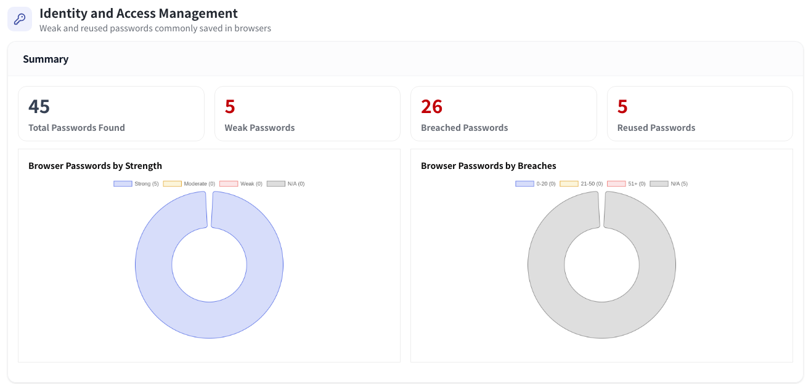
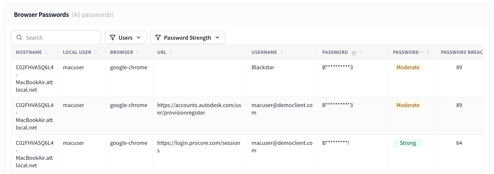
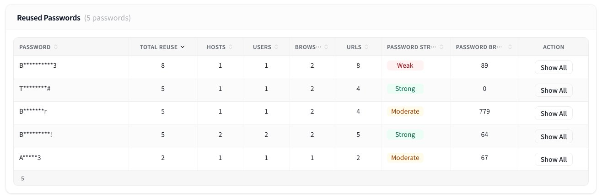

Attackers often get in with a password that is weak, reused, or already leaked. As part of a Risk Assessment, Telivy checks the passwords saved in users' browsers and flags each of those cases.

## How passwords are collected

When you deploy the Telivy agent, it includes a password analysis tool that reads the passwords saved in Chromium-based browsers such as Chrome and Edge, and in Firefox, on both Windows and macOS. The tool reads each user's browser profiles from inside that user's session, so it can only capture a user's passwords while that user is signed in. If a user is not signed in during the scan, the capture runs the next time they sign in.

Firefox passwords protected by a Firefox primary password cannot be read, so they do not appear in the results.

The analysis runs on the device. Cleartext passwords are never sent to or stored on Telivy's servers. Telivy stores a hash of each password, and a hash cannot be turned back into the password.

When the agent runs as an administrator, it schedules password capture for most user profiles on the device. Telivy works out the list of users from the profile folders, Microsoft Entra ID (Azure AD) accounts, and local and domain accounts on the machine. Some users can still be missed.

## What the analysis finds

The summary at the top counts the passwords found and how many are weak, breached, or reused.

<Frame>
  
</Frame>

<AccordionGroup>
  <Accordion title="Breached credentials">
    Stolen usernames and passwords are traded on the dark web, and attackers try them first. Telivy checks each saved password and username against known breach data. The **Password Breaches** column shows how many breaches a password appeared in, counted across all usernames. Any password with breach hits should be changed.

    In the example below, the first password has appeared in breach data 9.65 million times.

    <Frame>
      
    </Frame>
  </Accordion>

  <Accordion title="Weak passwords">
    Dictionary words and simple sequences such as `qwerty` take seconds to crack. Telivy rates each password on length, complexity, and character variety, and the **Password Strength** column shows **Weak**, **Moderate**, or **Strong**. **N/A** means the browser did not save the password or it could not be decrypted.
  </Accordion>

  <Accordion title="Reused passwords">
    One password used across many accounts means one leak opens all of them. The reuse table groups identical passwords and shows **Total Reuse**, plus how many hosts, users, browsers, and URLs share each one.

    <Frame>
      
    </Frame>

    Select **Show All** on a row to see every place that password is used.
  </Accordion>
</AccordionGroup>

## Acting on the results

Start with passwords that have breach hits, then the ones reused across many URLs, then the weak ones. For each, have the user change the password and turn on MFA for the account. A password manager makes unique passwords practical. The next scan shows whether the old passwords are gone.

## Related guides

<CardGroup cols={2}>
  <Card title="Microsoft 365 Security" icon="microsoft" href="/products/risk-assessments/microsoft-365-security">
    Accounts, MFA, and sign-ins in the tenant
  </Card>
  <Card title="Dark Web Scans" icon="user-secret" href="/learning-center/dark-web-scans">
    Leaked credentials tied to the client's domains
  </Card>
</CardGroup>
