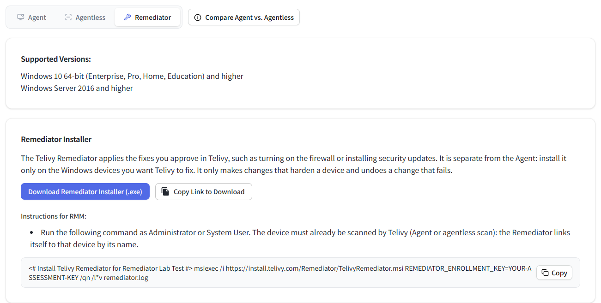
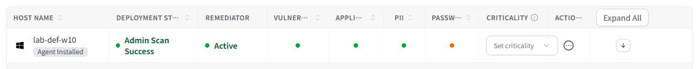
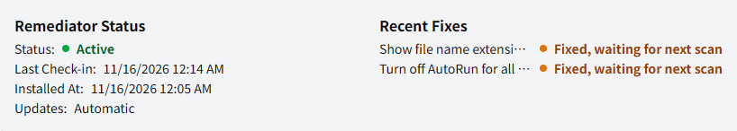
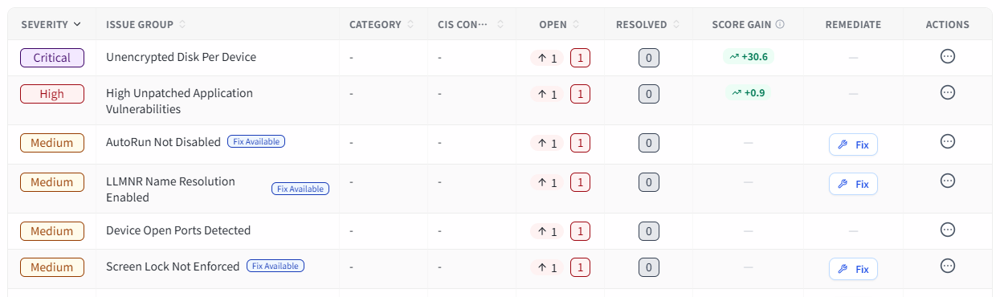
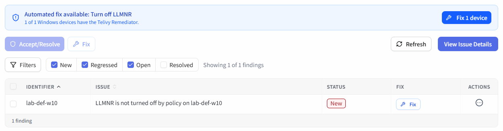
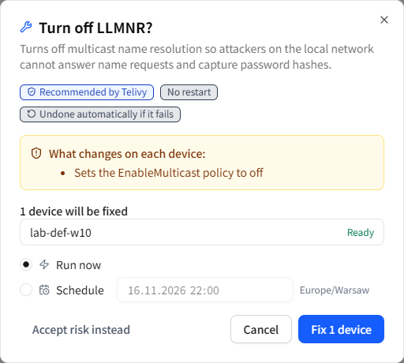
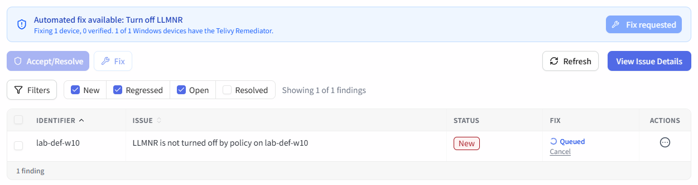
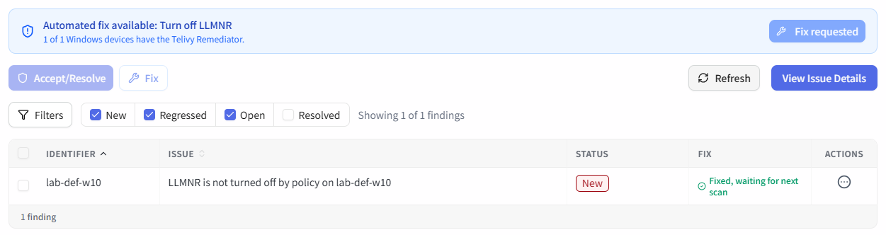
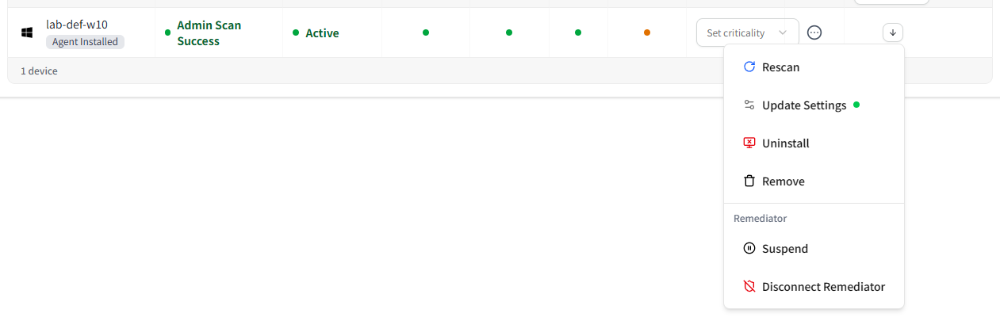

<Note>
The Remediator is in an early alpha for a small group of partners. Fixes and screens may still change.
</Note>

Telivy finds security issues on your clients' computers. The Remediator lets you fix many of them from the Telivy portal, without connecting to each computer.

## What the Remediator does

The Remediator is a small Windows service you install on the computers you want to fix. When you choose **Fix** on an issue in Telivy, the Remediator on that computer makes the change. For example, it can turn off AutoRun for USB drives, show file extensions, or turn on the Windows Firewall.

<CardGroup cols={2}>
  <Card title="You approve every fix" icon="circle-check">
    Nothing changes on a computer until someone chooses Fix in the portal.
  </Card>
  <Card title="It only makes computers safer" icon="shield-halved">
    It can turn protections on. It cannot turn them off.
  </Card>
  <Card title="Failed changes are undone" icon="rotate-left">
    If a fix fails halfway, the computer goes back to how it was.
  </Card>
  <Card title="Windows only" icon="windows">
    Windows 10 64-bit and newer, and Windows Server 2016 and newer. Macs are not supported.
  </Card>
</CardGroup>

The Remediator is not a remote management (RMM) tool. It cannot run your scripts or change anything outside the fixes listed below.

## Fixes available in the alpha

| Fix | What it does |
| --- | --- |
| AutoRun | Stops USB drives and discs from starting programs by themselves. |
| File extensions | Shows file extensions, so `invoice.pdf.exe` is easy to spot. |
| LLMNR | Turns off an old name lookup that attackers use to steal passwords. |
| NetBIOS | Turns off NetBIOS name lookup for the same reason. |
| SMB signing | Requires signed file-sharing traffic. |
| SMBv1 | Turns off the outdated SMBv1 file-sharing protocol. Needs a restart. |
| Local password length | Requires local account passwords of at least 14 characters. |
| Defender PUA protection | Lets Microsoft Defender block potentially unwanted apps. |
| Windows Script Host | Stops script files (such as `.vbs`) from running when opened. |
| Screen lock | Locks the screen after 15 minutes of inactivity. |
| Windows Firewall | Turns the firewall on. |
| Browser password manager | Stops Chrome and Edge from saving new passwords. See the note below. |
| Windows security updates | Installs released security updates for the vulnerabilities Telivy found. Installs security updates only, then restarts the computer. |

<Note>
**Browser password manager:** passwords already saved in the browser stay where they are. Telivy still finds them, so this issue stays open after the fix. The fix shows **Completed** instead of **Verified**.
</Note>

Telivy chooses which fixes are offered, and the list will grow during the alpha.

## Before you start

- **The Remediator must be turned on for your account.** If you don't see a **Remediator** tab in the install instructions, contact Telivy.
- **Telivy must already scan the computer**, with the agent or an agentless scan. The Remediator finds its computer in Telivy by the computer's name.
- **You need admin rights on the computer**, or an RMM that runs commands as Administrator or as the System user.

## Step 1: Install the Remediator

Open the assessment and go to **Setup > Deploy Agent > Instructions**, then select the **Remediator** tab. You can install the Remediator in either of two ways. Both install the same software. Use whichever fits how you manage the computers, on one computer or many. We recommend the command, run from your RMM.

- **Command (recommended):** copy the command under **Instructions for RMM**. Run it as Administrator or as the System user, from your RMM or from an administrator PowerShell window on the computer. The command downloads and installs the Remediator.
- **Installer file:** select **Download Remediator Installer (.exe)**, or **Copy Link to Download** to get a link to it. Run the installer as Administrator on the computer, by hand or through any tool you use to deploy software.

The command and the installer both belong to this assessment, so always take them from the assessment the computer is in.

<Tip>
The Remediator is separate from the agent. Install it on every Windows computer, or only on the ones you want to fix.
</Tip>

## Step 2: Check that the computer is connected

Go to **Setup > Deploy Agent > Deployment Status**. A minute or two after you install, the **Remediator** column shows **Active** for the computer.

Expand a row with the arrow on the right to see when the Remediator last checked in, when it was installed, and the latest fixes on that computer.

| Remediator column | What it means |
| --- | --- |
| **Active** | Ready to receive fixes. |
| **Not installed** | The Remediator is not on this computer yet. Install it as in Step 1. |
| **Not supported** | The computer does not run Windows, for example a Mac. |
| **Suspended** | You paused it. It accepts no new fixes until you resume it. See [Pause or remove the Remediator](#pause-or-remove-the-remediator). |
| **Update pending** | A newer version is on its way. It updates itself. |

## Step 3: Find issues you can fix

Open the assessment's **Risk** page. Issues the Remediator can fix have a **Fix Available** badge and a **Fix** button.

Select an issue to see each affected computer. The blue **Automated fix available** bar at the top names the fix and shows how many affected Windows computers have the Remediator.

## Step 4: Run a fix

You can start a fix in three ways:

- **Fix N devices** in the blue bar fixes every computer with this issue.
- **Fix** in a row fixes only that computer.
- Select several rows, then choose **Fix (N)** above the table to fix only those computers.

A window explains the fix before anything happens.

<Frame>
  
</Frame>

- **What changes on each device** lists exactly what the Remediator will change.
- The badges show whether a restart is needed.
- Each computer shows **Ready** when it can receive the fix.
- Choose **Run now**, or **Schedule** and pick a date and time. The time is in your browser's time zone.
- Confirm with **Fix N devices** or **Schedule for N devices**.

The computer picks up the fix within about 2 minutes. A computer that is switched off picks it up when it is back on.

If you don't want to fix the issue, choose **Accept risk instead** to record that you accept it on these computers.

## Fixes that need a restart

Some fixes, such as turning off SMBv1 or installing Windows security updates, only take effect after the computer restarts. These show a **Restart required** badge, and the window suggests **Schedule** so you can pick a quiet time.

| You choose | What happens on the computer |
| --- | --- |
| **Schedule** | At the time you picked, the Remediator applies the fix and restarts the computer about 10 minutes later. Anyone using the computer sees a notice first. Best for evenings or weekends. |
| **Run now** | The fix is applied right away, and the person using the computer is asked to restart when it suits them. They are reminded every 4 hours. If nobody restarts within 24 hours, the computer restarts as soon as possible. |

The person using the computer sees this Windows notice:

> **Restart needed**
> A security fix approved by your IT provider needs a restart to take effect.

<Warning>
A restart can close unsaved work. Tell your client before you run a restart fix, and schedule it outside working hours where you can.
</Warning>

## Step 5: Follow the result

The **Fix** column on the issue page shows how each computer is doing. A simple fix usually finishes within a minute or two of being picked up.

Just after you confirm, the fix is **Queued**. You can still **Cancel** it.

Once the computer has made the change, the fix shows **Fixed, waiting for next scan**. The issue stays on the list until Telivy scans the computer again. When the next scan no longer finds it, the fix shows **Verified**.

| Fix column | What it means | What to do |
| --- | --- | --- |
| **Scheduled** | Waiting for the time you picked. | Nothing, or **Cancel**. |
| **Queued** | Waiting for the computer to pick it up. | Nothing, or **Cancel**. |
| **Running** | The computer is making the change. | Wait. |
| **Waiting for restart** | The change is made. The computer needs a restart to finish. | Ask the user to restart, or wait for the automatic restart. |
| **Fixed, waiting for next scan** | The computer made the change. | Nothing. The next scan confirms it. |
| **Verified** | The latest scan no longer finds the issue. | Done. |
| **Completed** | The fix is done, but by design the issue stays open (browser password manager). | Nothing. Hover over the status for details. |
| **Still detected** | The change was made, but a later scan still finds the issue. | Choose **Retry**, or check the computer's policies. |
| **Failed** | The fix did not work. Often another security product or a policy blocked the change. | Choose **Retry**, or check the computer's policies. |
| **Failed, changes reverted** | The fix failed and the Remediator put the old settings back. | Choose **Retry**, or contact Telivy support. |
| **Cancelled** | You cancelled the fix before it started. | Start it again if needed. |
| **Missed** | The fix could not start near its scheduled time, for example because the Remediator was suspended. | Choose **Schedule again**. |

Hover over a status to see more detail.

## Pause or remove the Remediator

On the **Deployment Status** page, open a computer's **...** menu. The **Remediator** section has two options.

- **Suspend** pauses the computer. It accepts no new fixes until you choose **Resume** in the same menu. A fix that is already running finishes or is undone, so nothing is left half done. A scheduled fix that comes due while suspended still starts if you resume soon enough (within 2 hours for a restart fix, 6 hours otherwise). After that it shows **Missed**.
- **Disconnect Remediator** stops the computer from receiving fixes and withdraws any waiting fixes. Fixes already made stay in place. The Remediator stays on the computer and does nothing until you install it again, which connects the computer as new. To remove it completely, uninstall **Telivy Remediator** from the computer, for example with your RMM.

## Questions

<AccordionGroup>
  <Accordion title="Can the Remediator change anything without my approval?">
    No. It only runs fixes that someone chose in the Telivy portal, and only fixes that make the computer safer.
  </Accordion>
  <Accordion title="I fixed an issue but it is still on the list. Why?">
    The issue list is updated by the Telivy scan. After a fix, the Fix column shows **Fixed, waiting for next scan**. The issue is resolved after the computer's next scan.
  </Accordion>
  <Accordion title="A computer is missing from the fix window.">
    Check the Remediator column on the Deployment Status page. The computer needs the Remediator installed and **Active**, and it must run Windows.
  </Accordion>
  <Accordion title="The computer was switched off when I ran the fix.">
    The fix waits as **Queued** and runs when the computer is back on and connected. The same applies to a scheduled fix. For a restart fix, that means a restart about 10 minutes after start-up, with a notice to the user first.
  </Accordion>
  <Accordion title="Will the user see anything?">
    Most fixes run silently in the background. Fixes that need a restart show a Windows notice asking the user to restart. See [Fixes that need a restart](#fixes-that-need-a-restart).
  </Accordion>
  <Accordion title="Does it work on Macs?">
    No. Macs show **Not supported** in the Remediator column.
  </Accordion>
</AccordionGroup>
