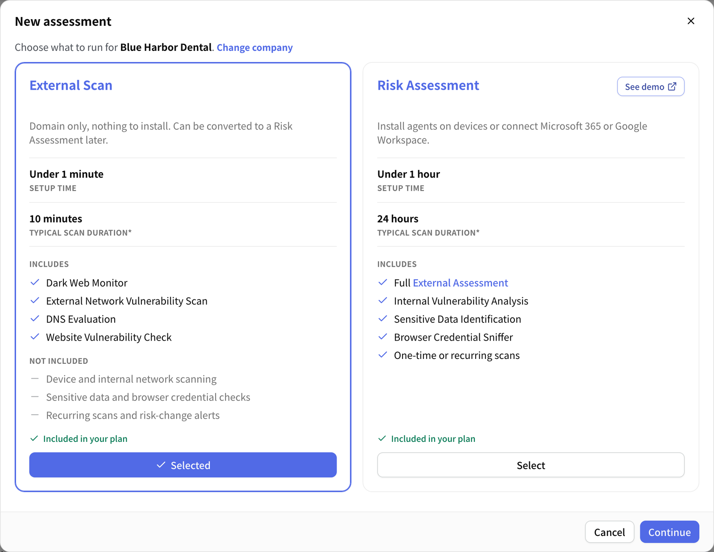

A Risk Assessment covers everything in an External Assessment and adds what only an agent inside the network can see: internal vulnerabilities, sensitive data on devices, saved browser credentials, and cloud accounts. Setup takes under an hour, and the scan usually finishes about 24 hours after the agents are deployed.

## Create the assessment

<Steps>
  <Step title="Open the New assessment dialog">
    Select **Create Assessment** in the top right of the portal. Telivy opens the **Companies** page with the **New assessment** dialog on top. To start from a company you already have, open the menu on its row on the **Companies** page and choose **New assessment**, which skips the next step. The button and the menu item are hidden when your master agency does not allow sub-agencies to create assessments.
  </Step>
  <Step title="Pick the company">
    Type in the **Company** search. Matching Telivy companies are listed under **In Telivy** with their **Client** or **Prospect** status and their number of assessments. When a PSA is connected, companies from the PSA that are not in Telivy yet are listed under **In** your PSA, and picking one imports it, or links it to the matching Telivy company. To add a company Telivy does not have, choose **Create new company** with the name you typed.
  </Step>
  <Step title="Choose Risk Assessment">
    The type picker shows the cards described in [the assessment cards](#the-assessment-cards). Select **Risk Assessment**, then **Continue**. **Change company** goes back to the company search. If your account only runs external scans, Telivy skips this step.
  </Step>
  <Step title="Fill in the details">
    The dialog shows the chosen **Company** and **Type**, each with a **Change** link, and these fields:

    - **Domain (optional)** appears only when the company has no domain on record. If you leave it blank, the assessment is created without a domain.
    - **Name (optional)** tells assessments apart when a company has more than one, for example "Main office". If the company already has a risk assessment, the dialog says so under the field.
    - **Weekly monitoring** rescans the company every week and sends alerts. It is off by default, and it only appears when your plan includes monitoring, your agency does not sign in through Unity, and the company is not a prospect. [Risk Monitoring](/products/risk-monitoring/overview) explains what changes once monitoring is on.
    - **Create** your PSA **tickets** opens tickets for findings, following your alert policies. It is on by default, and it only appears when a PSA is connected and the company is linked to it.
  </Step>
  <Step title="Create the assessment">
    Select **Create risk assessment**. The dialog closes, a message confirms the assessment was created, and the **Companies** list expands the company and highlights the new assessment. Open the assessment to deploy the agent and connect Microsoft 365 or Google Workspace.
  </Step>
</Steps>

### Settings outside the dialog

- **Country** and PII masking come from your agency's defaults under **Account → Assessment Defaults → PII Capture**, where admins select **Edit PII defaults**. [Data Security](/products/risk-assessments/data-security) explains what is stored with and without masking.
- **Company Status**, **Industries**, and **Anti Virus** are set with **Edit company** in the company's row menu on the **Companies** page. A company created from the dialog starts as a **Client**.
- If ThreatLocker blocks MSI installs, admins can turn on **Update without MSI installers (Windows)** under **Account → Assessment Defaults → Agent Updates**, where that section is shown.
- The assessment is created under your own user. To hand it to someone else, use **Reassign user** on the **Companies** page.

## The assessment cards

The picker shows a card for each assessment type with its setup time, typical scan duration, and what it includes:

- **External Scan**: dark web monitoring, an external network vulnerability scan, DNS evaluation, and a website vulnerability check. No agent needed.
- **Risk Assessment**: a full External Assessment plus internal vulnerability analysis, sensitive data identification, and browser credential analysis. **See demo** opens a sample assessment with example data.
- **Monitored Risk Assessment**: a full Risk Assessment with continuous monitoring, risk-change alerts, recurring scans, and remediation workflows. This card only appears for agency admins who sign in through Unity, and not for prospects. After **Continue**, it walks through **Client**, **Plan**, and **Schedule** steps (Foundations agencies have no **Plan** step). See [Unity and Cytracom](/getting-started/set-up-telivy-account/unity).

<Frame>
  
</Frame>

The line above each card's **Select** button says whether you can use it:

| Card says | Meaning |
| --- | --- |
| Included in your plan | You can create this assessment type now. |
| Not included in your plan | Your plan does not cover this type. Without Unity, use **Contact support to upgrade**. |
| Included with Foundations coverage | Shown on the **Monitored Risk Assessment** card for Cytracom Foundations agencies. |

Agencies that sign in through Unity see a second line under **Not included in your plan**, such as "Available with Assess, billed through Unity", and an action such as **Unlock with Assess** or **Manage in Unity**. [Unity and Cytracom](/getting-started/set-up-telivy-account/unity#what-the-create-assessment-cards-say) lists every variation.

<Warning>
  Allow the Telivy agent in the client's antivirus or EDR before deploying it, or the scan may be blocked or quarantined. See [Allow Telivy in AV and EDR](/products/risk-assessments/whitelist-telivy-with-av-edr).
</Warning>

## Next steps

<CardGroup cols={2}>
  <Card
    title="Deploy the Telivy agent"
    icon="download"
    href="/products/risk-assessments/agent-vs-agentless"
  >
    Windows and macOS, installed agent or one-time agentless scan
  </Card>
  <Card
    title="Scanning schedule"
    icon="clock"
    href="/products/risk-monitoring/scanning-schedule"
  >
    How often each check in the assessment runs
  </Card>
</CardGroup>
