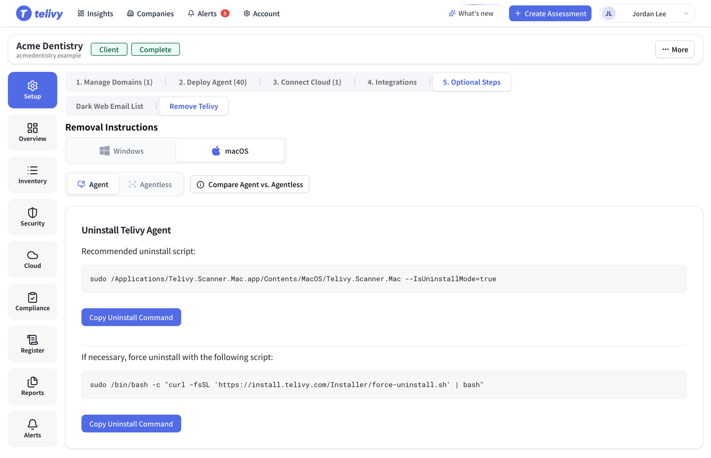

The uninstall commands are on the assessment's **Setup** tab under **Optional Steps > Remove
Telivy**. Select **macOS** under **Removal Instructions**, then **Copy Uninstall Command** next to
the option you need. Run it in Terminal on the Mac or from your RMM or MDM. Tools that
already run scripts as root do not need the `sudo` prefix. The data from the
Mac's latest scan stays in the portal and in any report you generate.

<Frame>
  
</Frame>

## Recommended uninstall

```bash
sudo /Applications/Telivy.Scanner.Mac.app/Contents/MacOS/Telivy.Scanner.Mac --IsUninstallMode=true
```

## Force uninstall

Use this when the recommended command fails or the app is damaged. The script unloads the
`com.cytracom.telivy.agent` background service, deletes its launch daemon, the
`/Applications/Telivy.Scanner.Mac.app` app and the
`/Users/Shared/Library/Application Support/Telivy` data folder, and removes the package
receipt. You can read it at
[install.telivy.com/Installer/force-uninstall.sh](https://install.telivy.com/Installer/force-uninstall.sh)
before you run it.

```bash
sudo /bin/bash -c "curl -fsSL 'https://install.telivy.com/Installer/force-uninstall.sh' | bash"
```

## Agentless scans

The agentless scanner installs nothing. Eject the disk image and delete the downloaded file.

## Related guides

<CardGroup cols={2}>
  <Card title="Install on macOS" icon="apple" href="/products/risk-assessments/install-telivy-agent-macos">
    Reinstall the agent or run the agentless scanner
  </Card>
  <Card title="Uninstallation FAQ" icon="circle-question" href="/frequently-asked-questions/uninstallation">
    Archived assessments and devices that keep the agent
  </Card>
</CardGroup>
