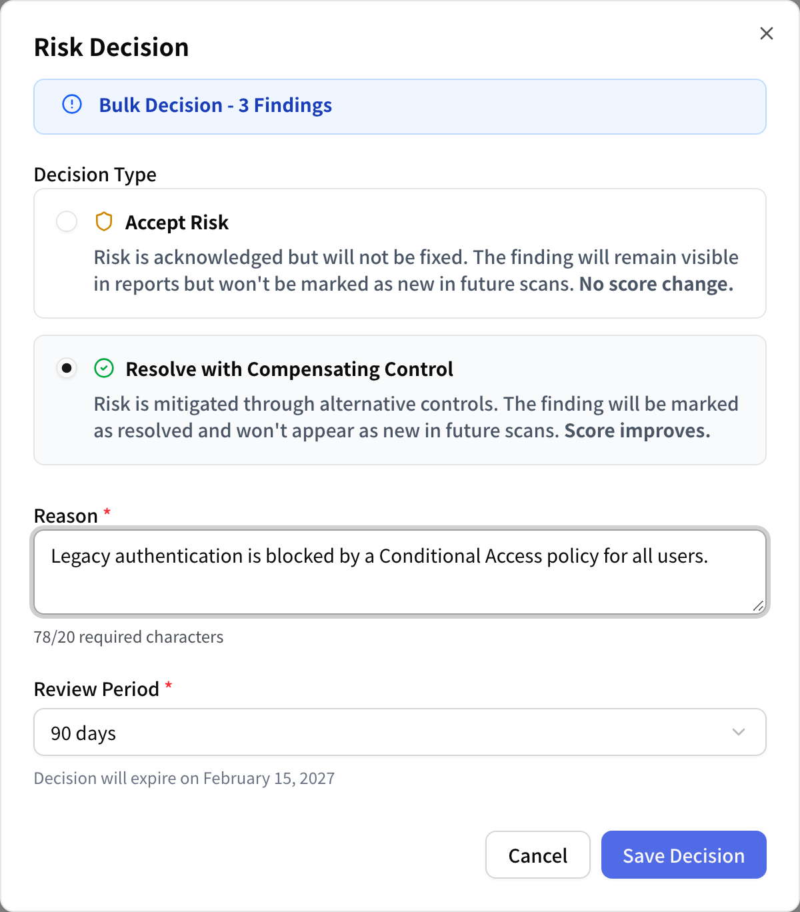
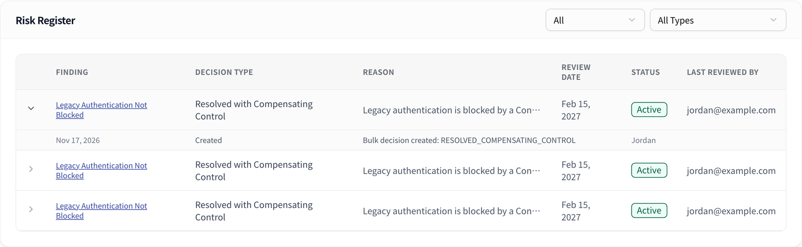

The Risk Register is the record of every decision made about a finding in an assessment. When
you accept a risk or resolve it with a compensating control, Telivy stores the decision with
your reason and a review date, and lists it on the assessment's **Register** tab. Every user
on the account can make decisions and view the register.

## Making a decision

Decisions are made from the assessment's findings view. You reach it by opening a finding
from the **Overview** tab, the **Compliance** tab, the **Cloud** tab, an alert, or a row in
the Risk Register.

<Steps>
  <Step title="Pick the findings">
    In a findings list, tick the findings you want to decide on and click
    **Accept/Resolve**. The button shows how many findings are selected. On a single
    vulnerability, use **Accept/Resolve** in the row's action menu instead.
  </Step>
  <Step title="Choose the decision type">
    The **Risk Decision** dialog offers two types:

    | Decision | Effect |
    | --- | --- |
    | **Accept Risk** | The risk is acknowledged but will not be fixed. The finding stays visible in reports but is not marked as new in later scans. The score does not change. |
    | **Resolve with Compensating Control** | The risk is mitigated by another control. The finding is marked as resolved and does not appear as new in later scans. The score improves. |
  </Step>
  <Step title="Give a reason">
    **Reason** is required and must be at least 20 characters long. It is shown in the
    register and in the decision's history.
  </Step>
  <Step title="Set the review period">
    **Review Period** is required and defaults to 90 days. Choose 30 days, 60 days, 90
    days, 180 days, or 1 year, and the dialog shows the date the decision expires. Choose
    **Custom date** to pick a date from today onward, or **Never expire** for a decision
    that has no review date. Then click **Save Decision**.

    <Frame>
      
    </Frame>
  </Step>
</Steps>

When you select several findings at once, the dialog shows a **Bulk Decision** header with
the number of findings. Findings that are already accepted can only be resolved, so
**Accept Risk** is disabled when the selection includes them. Resolved findings in the
selection are left out of the decision and of the count on the **Accept/Resolve** button.

<Note>
  A third decision type, **Resolved in PSA**, is recorded by Telivy when your connected PSA
  reports the finding's ticket as resolved. You cannot choose it in the dialog. See
  [PSA grouped tickets](/integrations/psa-grouped-tickets) for how findings reach your PSA.
</Note>

## Accepting and resolving vulnerabilities

Vulnerability (CVE) findings open in a dashboard with a **By CVE** tab, a tab that groups
them by device (or by domain or asset, depending on what the vulnerability affects), and an
**All findings** tab. Each row has an action menu with **Accept/Resolve**, which opens the
same Risk Decision dialog for the findings in that row.

### Patch status per device

In the per-device vulnerability rows, the **Patch status** column shows whether the installed
version of the product on that device is affected.

| Status | Meaning |
| --- | --- |
| Vulnerable | The installed version falls in the affected range |
| Patched | The installed version is outside the affected range |
| Not verified | Telivy could not decide. Hover over the badge for the reason |

**Not verified** has two possible reasons: Telivy could not read the installed version of the
product on the device, or the vendor has not published which versions are affected.

## The Register tab

The **Register** tab lists the decisions for the assessment, 50 per page.

| Column | What it shows |
| --- | --- |
| Finding | The finding the decision applies to. The name opens the finding |
| Decision Type | **Risk Accepted**, **Resolved with Compensating Control**, or **Resolved in PSA** |
| Reason | The reason given with the decision |
| Review Date | The date the decision expires, or **Never** |
| Status | How close the decision is to its review date |
| Last Reviewed By | The user who made or last changed the decision |

<Frame>
  
</Frame>

The **Status** badge reads **Overdue** once the review date has passed, the number of days
remaining when it is 60 days away or less, **Active** when it is further out, and **Never
expires** for a decision without a review date.

Expand a row with the arrow on the left to see the decision's history: each change with its
date, the action, what changed, and who made it.

Two filters sit at the top of the tab:

| Filter | Options |
| --- | --- |
| Review status | All, Overdue, Due in 30 days, Due in 60 days, Active |
| Decision type | All Types, Accepted, Resolved (Compensating Control), Resolved in PSA |

## Review status on the Overview tab

Once an assessment has decisions in its register, the **Overview** tab shows a **Risk
Register Review Status** panel with up to three counts: **Overdue**, **Due in 30 days**, and
**Due in 60 days**. A count only appears when it is above zero. Clicking a count opens the
Register tab filtered to those decisions.

## Related guides

<CardGroup cols={2}>
  <Card title="Risk Score" icon="gauge-high" href="/scoring/risk-scoring">
    How the overall Risk Score is calculated
  </Card>
  <Card title="Send findings to your PSA" icon="ticket" href="/integrations/overview">
    Findings resolved in your PSA show here as Resolved in PSA
  </Card>
</CardGroup>
