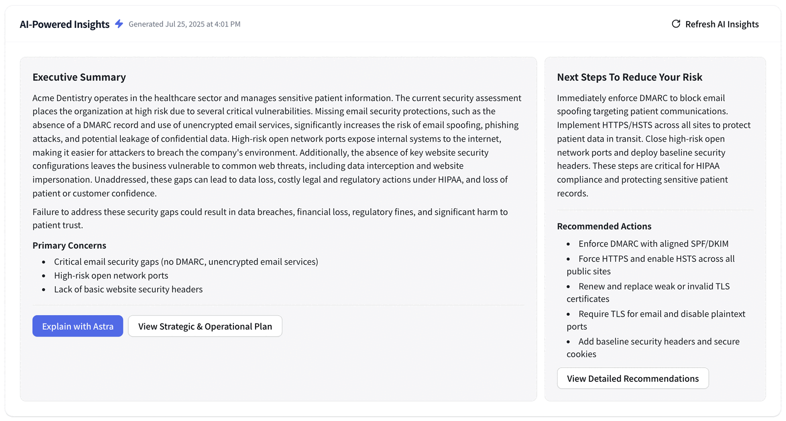

**AI-Powered Recommendations & Astra Chatbot** is an Early Access feature in beta. When your agency turns it on, every assessment's **Overview** tab gets an **AI-Powered Insights** card with an AI-written executive summary of the assessment, prioritized recommendations tied to its findings, and **Explain with Astra** for asking questions about the results.

## Turning it on

The feature is off until an Account Admin joins it for the agency. Other users see the Early Access page read-only.

<Steps>
  <Step title="Open Early Access">
    Go to **Account > Early Access** and find **AI-Powered Recommendations & Astra Chatbot** under **Available Features**.
  </Step>
  <Step title="Join">
    Select **Join**. Because the feature is marked sensitive, a dialog opens before it is turned on.
  </Step>
  <Step title="Confirm">
    Tick **I confirm I am authorized for this organization and understand the implications of enabling this feature**, then select **Enable Feature**.
  </Step>
</Steps>

To turn it off, select **Leave** on the feature under **Active Features**. The card then disappears from the Overview.

## Generating insights

Insights are generated per assessment. Until they exist, the card shows a button that depends on the scan:

| Scan state | What the card shows |
| --- | --- |
| Not started | "We'll prepare your AI insights as soon as the scan is complete." |
| In progress | **Generate Early Insights**, which builds preliminary insights from the data collected so far. You can regenerate them after the scan finishes. |
| Complete | **Generate Insights Now** |

Once insights exist, the card header shows when they were generated and a **Refresh AI Insights** button. If the assessment's findings change afterwards, an amber label such as "3 new findings since generated" or "Findings changed since generated" appears next to the title. Select **Refresh AI Insights** to bring the summary up to date. If generation fails, the card shows **Failed**, and you can try again with **Refresh AI Insights**.

## What the card shows

| Section | What it contains |
| --- | --- |
| **What Your Security Partner Delivered** | A short account of progress since the previous assessment. Only shown when there is a previous assessment to compare with. |
| **Executive Summary** | A narrative of the client's security posture, its business impact, and a list of **Primary Concerns**. |
| Next steps | A short summary of what to do next, under a heading the AI writes for the assessment. |
| **Recommended Actions** | The titles of the recommended fixes. **View Detailed Recommendations** opens each one with its description. |
| **View Strategic & Operational Plan** | Opens **Strategic & Operational Recommendations**, with **Strategic Priorities** for a vCISO and **Operational Tasks** for SecOps. |

<Frame>
  
</Frame>

Every recommendation is meant to be tied to specific evidence from the assessment, such as a finding, a count of affected systems, a hostname, or a breach. Generic advice that cannot be tied to a finding is left out.

On a Risk Assessment, **Export Executive Summary** in the card header downloads the executive summary as a report.

## Asking Astra

Select **Explain with Astra** under the executive summary to open a chat with Astra, Telivy's assistant. Astra starts with the insights on the card as context, so you can ask what a concern means, why an action is recommended, or how to explain it to the client.

## What is sent to the AI service

When you generate or refresh insights, Telivy asks its AI service to write a report for the client's company name and domain. The AI service reads the assessment's own results to build the summary.

## Related guides

<CardGroup cols={2}>
  <Card title="Billing, Usage, and Early Access" icon="flask" href="/getting-started/set-up-telivy-account/billing-usage-and-early-access#early-access">
    How Early Access features are turned on and off
  </Card>
  <Card title="Risk Scoring" icon="gauge" href="/scoring/risk-scoring">
    How Telivy scores and ranks findings
  </Card>
</CardGroup>
